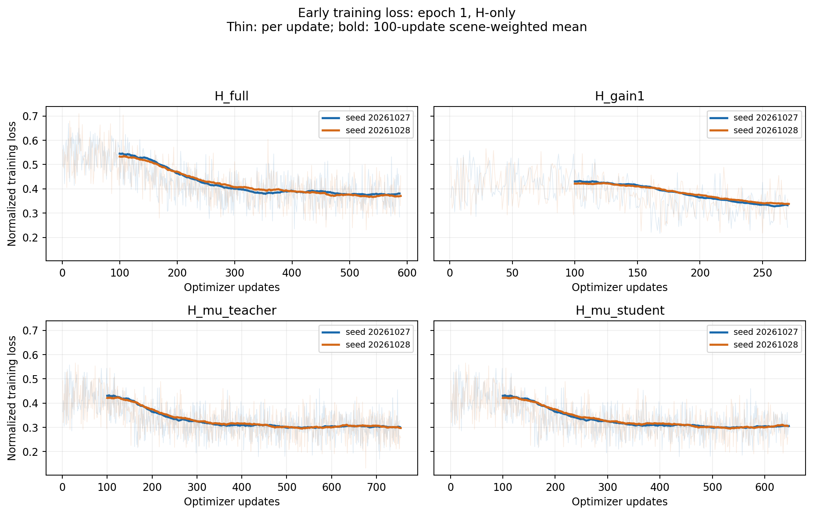

# 本机 ReCogDrive 蒸馏：代码与开训快照

本分支保存本机实验代码、真实开训记录及后续用户要求的变更。训练正在进行；第8轮四组完整Navtest已完成并核验，A/B/C/D分别88.726671/89.121595/89.286516/89.319965，同条件Base90.679224。Test为主判断和权重选择口径，后续轮次及A不同loss五点相关性仍在进行。

## 最新覆盖：Test PDMS选择与固定服务器（2026-10-27 23:15 UTC）

用户要求“不再以验证集为判断指标，使用测试集的PDMS结果”。以此覆盖原指南和下文历史开训计划中的Validation-best选择及Test晚启动门槛。

- 主判断与权重选择：完整Test 12,146场景 × 显式S0–S4，在epoch8/16/24/32/40评价；最高PDMS，完全同分取更早epoch。Test参与模型选择，不能称为独立held-out最终测试。
- 四组单seed20261027完整40轮/53,640更新继续，原训练进程、代码HEAD、checkpoint资产/优化器/RNG身份不变；Test样本和教师目标不进入训练与损失定标。
- 原训练内嵌Validation及最终表征、功能、新噪声Validation保留为诊断，不按Val排名或选权重。旧Val证据保留。最终选取写入新`checkpoints/test_pdms_best.json`和`TEST_PDMS_SELECTION_LOCK.json`。
- [实际Test选择接线、源码与用户指令](local_teacher_rebuild/native_candidates_20261027/engineering/test_pdms_selection_20261027/)包含选择器、评测准入、完整端点执行owner、报告接线和CPU检查。该外部接线是必需入口；不能只直接调用冻结训练目录中的旧双seed/Validation默认控制器。
- 四组在正式许可vla-zt、tsinghua-zt、tsinghua-zt4、tsinghua-zt5的原16GPU分配上继续训练，Test共享相同GPU。四个撤回临时节点读审计均未发现本项目进程，无GPU训练重启。[资源核查证明](reports/round1_update_20261027T2310Z/resources/COMPLETE.json)。
- [完整训练loss历史与逐轮表格](local_teacher_rebuild/native_candidates_20261027/engineering/test_pdms_selection_20261027/loss_history_20261027T2310Z/LOSS_HISTORY_ANALYSIS.md)：截至该快照，A16轮H下降50.84%，B15轮48.79%，C/D10轮31.56%/31.54%；不是持续平台，仍不能将训练误差下降当作PDMS提升。

## 当前实验范围

- 当前保留 **20261027** 一个 training seed，四组：H_full、H_gain1、H_mu_teacher、H_mu_student。
- 20261028 的四个重复 run 已按用户要求停止，已有权重、日志及实际停止证明保留，释放 16 张 GPU 的任务分配。单 seed 调度控制器已接续；四个保留训练进程继续运行，PID、启动时间、命令和原始attempt均未改变。
- 每个保留 run 仍训练全部 85,813 场景、40 epochs，global batch=64，world_size=4、microbatch=1、累积16次；每 epoch 1,341 次更新，共53,640次。
- 用户已取消五类额外资格验收，采用显式 `USER_AUTHORIZED_BASIC_NORMAL_START`。未执行的验收没有标为通过。保留实际训练的有限 loss/梯度检查、梯度裁剪和正常 checkpoint 保存/加载。

## 源码身份与入口

实际运行的训练代码提交为 **`0a58bd8e6271e26103512add2c5cb7816d7eb8f1`**。本分支在该提交上新增发布资料；运行中的源码 HEAD 保持原值，以兼容已有 checkpoint 的代码身份。

- [学生代码](student_distillation/)
- [有效基础配置](configs/student_distillation/)
- [本机教师完整重建代码](local_teacher_rebuild/native_candidates_20261027/)
- [教师缓存无损读取](scripts/student_distillation/read_teacher_cache.py)
- [原始实验指南](docs/recogdrive_no_routing_distillation_round1_guide.md)
- [保留四组的实际 effective_config 与资产身份](reports/round1_initial_20261027/active_seed20261027/)

冻结证据基线为 `6bb7119583513094a169b4c2f2dc2a05ac293aa3`；完整原研究方法源码证据为 `f85d4e557b12a7d05f5deb8d1640834cacd94d32`。本轮教师使用本机完整重拟合结果，PPU 参数及分数仅作历史证据。

冻结训练入口原先注册两个 seed。当前单 seed 计划以本分支保存的用户指令和实际控制器接续记录为准；重跑时应使用配套单 seed 操作入口，避免直接套用原双 seed 默认值。

[单 seed 调度源码](local_teacher_rebuild/native_candidates_20261027/engineering/single_seed_resource_saving_20261027/)在独立进程中缩减注册、选择锁、评测子进程和报告范围，训练命令保持原样。[14:58真实接续证明](reports/round1_initial_20261027/resource_transition/ACTUAL_LIVE_ADOPTION.json)显示四个保留run分别已到A2538、B1159、C3352、D2785步，均沿用唯一原始训练attempt。源码中的机器路径和OWNER_SPEC对应当前平台，迁机需配置当地路径。

## 教师与学生方法

本机教师仅做 **D／full384先聚类／共享D48／K8／增强double**。使用本机 Base 重筛、GT 接口反传配对、子空间及专家重新拟合，再进行各场景固定分支选择。冻结教师及完整 Train/Test 评测已经完成。

| 完整人群 | 场景数 | 本机 Base PDMS | 本机 full 教师 PDMS |
|---|---:|---:|---:|
| Train | 85,813 | 95.07208906 | 97.52980208 |
| Test | 12,146 | 90.67922438 | 96.55443602 |

以上是离线选择教师上限，不是学生成绩。Train gain1 教师为97.47006368，严格增益>1点保留36,359个修复，其余49,454个目标为Base。

学生冻结 VLM、feature_encoder、原状态编码器及 RL DiT。共享连续适配器使用4个 learned queries、hidden256、两层 cross-attention、4heads、FFN expansion4、dropout0，读取有效 post384 token 与24维普通状态，输出48维系数，经固定D48解码为共享384维修复量。最终层零初始化，保留完整padding和原生动作链；没有专家分类、gate、MoE或候选选择。

| 组别 | 表征目标 | 功能损失状态来源 |
|---|---|---|
| A / H_full | full | 无 |
| B / H_gain1 | gain1 | 无 |
| C / H_mu_teacher | gain1 | 冻结教师链 |
| D / H_mu_student | gain1 | 当前学生接口detach后重新生成 |

四组沿用AdamW LR1e-4、指定不衰减组、clip1、warmup1,341步及cosine至1e-5。C/D前4个epoch只训练H，接着2个epoch将功能权重升至0.5，随后34个epoch联合训练。FP32适配器/动作头，TF32关闭。固定损失尺度只来自Train，已实际计算完成，见[定标数据](reports/round1_initial_20261027/protocol/CALIBRATION.json)。

## 实际开训与初期 loss

14:22:51 UTC 的记录证明原先8个run均已发生真实优化更新，不能将其理解为仅提交脚本。随后用户要求节省资源，20261028的四个run已于14:49:52–54实际停止，保留20261027。

第一次完整epoch统计已回填：

| 保留 run | 完整epoch1场景加权平均loss |
|---|---:|
| H_full_seed20261027 | 0.3914273065 |
| H_gain1_seed20261027 | 当时仍为partial，未伪记完整均值 |
| H_mu_teacher_seed20261027 | 0.3147765080 |
| H_mu_student_seed20261027 | 0.3147765080 |

完整epoch均核对1,341次更新、85,813个真实样本及checkpoint实际SHA。C/D此时按课程只使用H，因此同seed结果一致。

初期快照中，各run前100步与最近100步的loss均值下降19.8%–30.5%，平滑曲线近期趋于平台；逐batch有波动。该观察不能替代PDMS评测。

每步loss持续写入训练日志；独立CPU汇总保存每epoch JSON/CSV，按真实样本数加权，尾批53例按53计入，零/非零目标H按各自数量统计，原始μ和实际加权功能项分别记录。读取按每run预计epoch完成时间加缓冲调度。

## 后续正式评价

每个epoch保存checkpoint。完整Test为12,146场景×S0–S4，在epoch8/16/24/32/40的实际权重完成后评测并按PDMS选择best，另保留epoch40 last。四组第8轮Test现已实际生成原生轨迹和真实评分，[运行接续证据](local_teacher_rebuild/native_candidates_20261027/engineering/test_pdms_selection_20261027/ACTUAL_ADOPTION.json)记录完整人群协议和四rank实际输出，当前尚非完整Test结果。最终best/last锁仍要求所有四组完整40轮及全部5个完整Test端点。原Validation17,475×S0–S4及best的S5–S9只作诊断；Train行为用锁定8,192场景面板，完整Train表征误差另报。

## 文件与限制

- [发布文件SHA清单](reports/round1_initial_20261027/PUBLICATION_MANIFEST.json)
- [实际开训快照](reports/round1_initial_20261027/startup/STARTUP_OBSERVATION.1422Z.json)
- [停止重复seed的真实证明](reports/round1_initial_20261027/resource_transition/ALL_FOUR_SEED28_STOPPED.json)
- [单seed用户指令](reports/round1_initial_20261027/protocol/SINGLE_SEED_USER_INSTRUCTION.json)
- [历史20261028配置与统计](reports/round1_initial_20261027/cancelled_seed20261028/)

本次发布包含源码、配置、指纹、初始日志快照与统计，没有打包RL/VLM大权重、NAVSIM原始数据、505GB Base缓存、全量教师目标或训练checkpoint。JSON中的本机路径是实际执行溯源信息，迁机需映射并按SHA核对。完整实验报告待训练、验证和测试实际完成后另行提交。

## A组不同loss权重与完整Test PDMS相关性

用户要求已登记，预先选择epoch1/4/8/12/16，复用正式Test8/16并并行补评Test1/4/12；每点同时重算固定Train8192面板H。完整5点仍在生成，未给出任何相关系数。代码、实际启动记录、冻结输入和[四组方法说明](local_teacher_rebuild/native_candidates_20261027/engineering/loss_pdms_correlation_20261027/METHODS_FOUR_ARMS.md)位于[独立分析目录](local_teacher_rebuild/native_candidates_20261027/engineering/loss_pdms_correlation_20261027/)。本诊断不扩展正式best选择端点，也不改训练或增加物理GPU。

## 首批完整Navtest结果（2026-10-28 00:18 UTC）

[四组第8轮完整评分与A组已完成补评](reports/navtest_epoch8_20261028/NAVTEST_EPOCH8_RESULTS.md)。所有四组当前都低于Base；A第4/8/12轮分数随在线loss下降而下降，完整5点相关系数需等第1/16轮完成。当前不把训练loss下降表述为驾驶能力提升，四组完整40轮预算和后续所有评测继续。
