# ReCogDrive On-Policy Distillation 研究报告

## 研究结论

Q1（固定开发集主分析：学生链 OPD 优于轨迹 SFT 和教师链 KD）：**INCONCLUSIVE**。E3−E1=0.039512 [0.014204, 0.064478]；E3−E2=0.002052 [-0.000723, 0.005638]；E3 相对 IL 增益=0.016996 [0.007853, 0.029047]。优势、绝对能力迁移和训练损失下降分别判断；独立测试确认及跨split稳定性在后文单列。

Q2（固定五次配对评价下的负迁移）：**SUPPORTED**。E3 的 M_minus=0.013246 [0.007351, 0.020590]，独立高分保持率=0.982312 [0.970644, 0.990133]。不把每个负值都标成已确定的场景期望退化。Anchor/GT/gate 的具体缓解结论分别列于下表和遗忘报告，不由平均分替代。

Q3（进一步 DiffGRPO 超过 RL 教师）：**NOT_RUN**。E5未建立预登记的正向开发集泛化收益；因此不扩展正式E6。该停止来自科学门槛，非GPU不足。已运行原生DiffGRPO/OPD四步真实集成训练、独立连续4步与2+恢复2步的一致性验证，以及单步梯度校验；零OPD权重与原生loss/gradient精确一致，联合梯度有效且教师不变。它们是工程集成证据，不是超过教师的性能证据。

## 模型与算法核验

采用官方 IL 学生与 RL 活动动作头教师；IL/RL 的结构一致，加载器不选择 RL 的 old_policy。所有核心张量必须加载，完整 missing/unexpected/shape mismatch 记录在02报告及外部 audit/checkpoints.json。冻结同一1536维 VLM，只训练384维 small DiT 动作规划器，共34,329,219参数。八点三维轨迹、原生 norm_odo/denorm_odo、五步 DDIM 均未改动；专家、残差、未来目标等路径关闭。OPD显式兼容层恢复官方系统提示词边界换行与左侧fixed2800 padding，保留全部hidden states；真实8场景与固定官方源码逐元素一致。首轮动态padding批次为INVALID，统一重做且不合并，详见08报告。

DDIM adapter 与原 get_action 的逐步状态、均值及最终轨迹误差为0，E0-COPY 与 RL 误差为0。原生随机方差不能由 ddim_eta 配置名推断；实际路径含标准差下界和截断噪声，所以主版本匹配原生p_mean_variance返回的clamp前proposal均值MSE，不能宣称Gaussian KL，也不把它当作clamp后核的严格期望。最终clamp完整保留在rollout/parity/评分中。可选未截断共享方差 KL 仅有实现和正确性测试，正式性能消融 NOT_RUN。

[DiffusionOPD](https://arxiv.org/abs/2605.15055) 的关键是由当前学生产生去噪状态，再用冻结教师监督这些状态。E1 是最终轨迹伪标签的原生噪声预测训练，E2 的状态来自教师，E3 的状态每轮来自当前学生。所有链 detach，重新预测学生转移时才建立梯度。这里没有 environment-level on-policy；[Flow VLA 多教师工作](https://arxiv.org/abs/2610.21522)涉及的环境互动不能移用于固定日志实验。[PIVOT-Q](https://arxiv.org/abs/2610.05745)的行为保护思想是相关参考，本研究不声称复现其量化场景。

## 数据与受控实验

训练4115场景/50 log，校准518/4，固定开发1696/16；按完整 log 和父驾驶记录互斥。它们来自官方 navtrain，未参与本次新增训练不等于底模从未见过。VLM缓存只保存原生可见观测和实际动作头输入 token；8个在线场景与缓存的 token/轨迹误差为0。GT仅训练使用，metric cache 与 gate 是标签，不进入VLM编码。

七组正式实验各1000次实际更新、global batch8、三个独立训练种子42/43/44；配对推理种子1101–1105。共同 IL 初始化、数据顺序和初始噪声，两个学习率槽位，只有校准集决定学习率。Anchor/GT权重在固定训练样本按梯度尺度校准后锁定，不能从审核效果继续调节。E5 重新从 IL 开始，并不继承 E4 的额外训练。

|实验|开发集 PDMS（95% CI）|相对 IL 的 G（95% CI）|M+|M−|单次零分比例|
|---|---:|---:|---:|---:|---:|
|E0-IL|0.9148|0（共同参照）|0|0|—|
|E0-RL|0.948507 [0.918638, 0.965181]|0.033724 [0.020850, 0.050554]|0.0431|0.0094|0.74%|
|E0-COPY|0.948507 [0.918638, 0.965181]|0.033724 [0.020850, 0.050554]|0.0431|0.0094|0.74%|
|E1|0.892267 [0.861671, 0.920666]|-0.022517 [-0.050537, 0.008824]|0.0286|0.0511|5.66%|
|E2|0.929727 [0.893315, 0.949704]|0.014944 [0.005739, 0.026175]|0.0295|0.0146|2.08%|
|E3|0.931779 [0.896527, 0.951763]|0.016996 [0.007853, 0.029047]|0.0302|0.0132|1.84%|
|E4-A|0.930758 [0.893992, 0.951143]|0.015975 [0.008423, 0.025503]|0.0277|0.0117|1.91%|
|E4-B|0.922729 [0.888514, 0.942368]|0.007945 [0.003285, 0.016011]|0.0143|0.0064|2.14%|
|E4-C|0.922684 [0.888070, 0.942219]|0.007901 [0.003210, 0.015861]|0.0141|0.0062|2.12%|
|E5|0.906451 [0.857294, 0.933751]|-0.008332 [-0.023835, 0.000629]|0.0118|0.0201|3.58%|
|E6|NOT_RUN（正式比较）|真实4步集成已运行|—|—|—|

95%主区间按完整NAVSIM log、训练种子与配对推理种子分层bootstrap（2000次），保留log内相邻场景相关性；冻结E0基线不引入未知的历史训练种子变异。点估计为场景加权均值。实质性门槛PDMS0.002，退化幅度减少0.0005。同父驾驶记录的跨log相关性在后文以明确事后的较粗聚类敏感性分析检查，不替换主结果。校准只有4个log，超参数选择可能不稳定；三种子也不足以穷尽训练随机性。有限五次采样不证明单个场景的精确期望变化。

## OPD 是否提供额外价值

E3/E1状态=SUPPORTED，E3/E2状态=INCONCLUSIVE，E3/IL状态=SUPPORTED。训练 loss 的下降只说明转移拟合；最终动作裁剪、原生随机采样与闭环跟踪可能使很小的中间误差对应离散零分。真实训练链的 E2/E3 状态分布、教师响应差异、各步 MSE 和梯度贡献见 diagnostics 与 Fig3。不能把状态分布有差异本身当成 OPD 性能优势。

E4/E5 保护结论：E4-A: INCONCLUSIVE; E4-B: INCONCLUSIVE; E4-C: INCONCLUSIVE; E5: INCONCLUSIVE。逐场景正分到零分、原失败修复、教师成功但学生失败、双方失败但学生改善、NC/DAC/TTC新增违规和原高分保持分别记录，避免只展示平均分或成功案例。

## 教师质量、gate 与偏差

RL 教师平均优于 IL，开发集仍有 89 场景的五次平均下降超过0.02。训练静态 gate 依据五次配对差值的LCB，z=1、margin0.03并检查逐样本NC/DAC/TTC；z=1不是95%置信保证。质量 A/B/C/D 与有效gate不是同一概念。只在A且gate通过时接受强教师监督，B/C保护IL，D不假定教师有效。GT/anchor/opd各有独立归一化；空gate不能自动变成无条件OPD。

选择性监督改变有效训练暴露分布，可能偏向可修复但稀少的场景；静态gate依据原始IL，不保证更新后仍是最优选择。为避免将分布变化误当因果机制，使用共同初始化、相同训练场景/预算，并报告每类暴露、类别诊断和训练外表现。开发/测试类别图不参与训练选择。

E5相对同学习率、同GT/Anchor权重的均匀监督E4-C，开发集PDMS差=-0.016233 [-0.034147, -0.005694]，M_minus差=0.013894 [0.005273, 0.030854]。当前选择性配方的额外价值状态为NOT_SUPPORTED；相对IL的预设实质性增益状态为NOT_SUPPORTED。这不推翻所有门控方式，也不区分当前分配策略内部各机制的独立作用。最终测试没有临时追加未入选E4-C，对测试整体配方差异不作同组件gate因果归因。

## 最终测试确认

官方 navtest 12146 场景、136 个 log；精确匹配仓库官方 token 清单。IL=0.863638，RL=0.906643。E2 PDMS=0.868848 [0.853746, 0.883689]，G=0.005210 [-0.004681, 0.014331]。 E3 PDMS=0.873124 [0.858163, 0.887631]，G=0.009486 [-0.000043, 0.018901]。 E5 PDMS=0.855966 [0.839245, 0.871164]，G=-0.007673 [-0.016293, -0.001569]。 E4-A PDMS=0.874942 [0.861479, 0.888669]，G=0.011304 [0.002814, 0.019547]。 修正批次所有候选在锁定cal选择后一次性确认，测试结果不反向修改方案。工程修正前曾查看无效v1测试基线均值；未查看v1方法测试聚合。此数据接触限制与修正原因在08报告披露。

关键测试配对差：E3_vs_E2：PDMS差=0.004276 [0.000944, 0.007225]，M_minus差=-0.002823 [-0.006218, 0.001234]；E4-A_vs_E3：PDMS差=0.001818 [-0.000579, 0.004608]，M_minus差=-0.003360 [-0.005510, -0.001479]；E5_vs_E3：PDMS差=-0.017159 [-0.028356, -0.005611]，M_minus差=-0.003031 [-0.015844, 0.008441]；E5_vs_E4-A：PDMS差=-0.018976 [-0.029529, -0.008718]，M_minus差=0.000329 [-0.011000, 0.011003]。

开发主分析与测试确认分别保留，不合并曲线。跨两个split的稳定额外价值描述为 **INCONCLUSIVE**；测试OPD/KD状态=SUPPORTED。一致性描述沿用相同实质性门槛，不是新增显著性检验。

## 成本、复制对照与适用范围

正式1000步动作头训练（三种子平均，不含共享编码/教师库/评测）：

|方法|秒/种子|峰值显存GiB|
|---|---:|---:|
|E1|383.7|2.04|
|E2|1029.5|6.36|
|E3|1174.9|6.36|
|E4-A|1303.8|6.49|
|E4-B|1256.1|7.39|
|E4-C|1385.6|7.53|
|E5|1344.7|7.53|

独立20场景、预热1场景的原生学生在线推理中位数为0.3760秒/场景，包含图像加载、VLM和规划器；缓存输入后的规划器为0.1481秒，正式单候选物理评分为0.0289秒。测量来自活跃共享服务器，不是隔离延迟基准。E2与E3每种子均实际执行40,000个teacher样本步查询；E3另有40,000个学生rollout样本步，未给E3增加优化更新预算。

有效修正批次的全部任务累计预留GPU时间为35.90 GPU小时，包含启动与评测，不等同于GPU利用率。

无效v1仍计入工程成本：40.47 GPU小时，两批累计76.36 GPU小时，未超过预登记128小时上限。五台主机的本任务pause标记已移除，原压力自动化恢复观察；没有终止真实他人任务。失败与CPU编排交接记录在外部accounting.json中保留，已修复的问题不从历史中删除。

任务输出实测表观容量371.95 GiB，包含INVALID历史与有效重跑，低于500 GiB预算；既有外部原始数据、源权重及复用训练metric cache不在该容量口径内。

E0-COPY直接复制教师权重即可精确恢复教师输出，且没有蒸馏训练成本。相同架构、同一VLM、没有部署约束时，OPD不能仅凭逼近教师证明工程价值；需要保持IL能力、选择性传递或整合互补教师的真实优势。推理只调用单学生，不增加教师或环境反馈。Fig8与成本表记录实际训练时间、峰值显存和教师查询；输入编码、静态gate、教师缓存和调参为共享前置成本，另列总账，不隐藏在某一方法中。

测试集E3−RL教师的配对PDMS差为-0.033519 [-0.043104, -0.023969]，当前学生明确未达到直接复制教师的平均水平。

E6 训练使用原生自定义 PDM reward，EP/TTC/Comfort权重为10/5/2；正式评测 PDMS 为5/5/2，两者分开记录。本轮没有添加世界模型、专家路由或额外对齐任务。候选结果不支持时按协议停止对应路线，不继续搜索新的损失来追逐正结论。缺少正式E6结果时，无法区分教师约束、教师能力边界与GRPO本身限制，不作归因。

## 后续研究边界

本轮路线取舍：保留E2/E3与Anchor作为受控研究基线；开发集未证实学生链相对教师链的稳定额外价值，不扩大当前OPD损失搜索。停止当前静态Advantage Gate配方，正式E6不绕过门禁。单教师、同架构且无其他部署限制时，优先复用已验证的RL活动动作头；当前学生没有证明替代直接复制教师的实际收益。后续若研究互补教师或共同失败场景，应另立协议，不能作为本轮负结果后的临时扩展。

多教师值得继续的条件是有可重复的互补场景能力和超出单教师复制的收益；必须控制教师选择与数据暴露预算。时刻化NAVSIM物理反馈可用于训练特权教师，但未来对象占用只能作为训练标签/特权路径，部署学生仍只能使用当前与历史观测。不同质量教师的选择性传递需要训练外校准，不能用测试反馈构造gate。双方共同失败的场景需要新的合法探索或监督信息，反复复制固定教师不能自动产生缺失能力。泛化研究需按完整驾驶记录留出、跨日志/数据域验证，并保留不利结果，而非记忆训练token。

## 复现与证据

锁定协议：configs/opd/protocol.yaml（SHA256 4e49e7d2fcceee397fca64df3b5611d7f84c9915d0506fb796a307ecefa7b562）。分支 research/recogdrive-opd-20261020，原始HEAD884ea1d0f67c60821d61033d61efb10916d16929。最终推送提交与远端核验见外部 /mnt/project/VLA-AD/outputs/recogdrive_opd_20261020/official_v2/delivery.json。

完整产物：/mnt/project/VLA-AD/outputs/recogdrive_opd_20261020/official_v2。逐场景轨迹在 evaluation/<split>/<model>/predictions，分项/事件在 scores，训练链与 optimizer 在 runs。每个任务的实际命令、PID/start ticks、代码来源hash、完成或失败状态在 jobs。文档 docs/RECOGDRIVE_OPD_RUNBOOK.md 给出全部入口；figures.py从实际结果生成Fig1–8，空结果不画虚拟曲线。

实际命令：`python scripts/opd/analyze.py --suite E0-E6 --split dev`；`python scripts/opd/figures.py --split dev --cases`；`python scripts/opd/report.py`。正式E6未获门禁时不得绕过admission直接训练；小规模集成可用 `python scripts/opd/train.py --exp E6 --stage smoke --variant IL_JOINT`，新运行需不同name。

## 数值诊断、失败案例与解释边界

先对每个策略、每个场景的五个推理种子求均值，再计算相对IL的G、M_plus、M_minus。先对每个策略截正/负，再跨训练种子平均。单次输出零分率与五次均值零分率分列。区间按完整log、训练种子和配对推理种子bootstrap，未经多重比较校正。

E2_vs_E1：PDMS差=0.037460 [0.012257, 0.063370]；M_minus差=-0.036508 [-0.058711, -0.016347]（正值表示更多下降幅度）。

E3_vs_E1：PDMS差=0.039512 [0.014204, 0.064478]；M_minus差=-0.037866 [-0.059676, -0.017461]（正值表示更多下降幅度）。

E3_vs_E2：PDMS差=0.002052 [-0.000723, 0.005638]；M_minus差=-0.001358 [-0.004589, 0.001009]（正值表示更多下降幅度）。

E4-A_vs_E3：PDMS差=-0.001021 [-0.009186, 0.003457]；M_minus差=-0.001508 [-0.005492, 0.004007]（正值表示更多下降幅度）。

E4-B_vs_E3：PDMS差=-0.009050 [-0.017268, -0.000697]；M_minus差=-0.006884 [-0.014047, -0.002343]（正值表示更多下降幅度）。

E4-C_vs_E3：PDMS差=-0.009095 [-0.017609, -0.000777]；M_minus差=-0.007007 [-0.014122, -0.002437]（正值表示更多下降幅度）。

E5_vs_E3：PDMS差=-0.025328 [-0.048150, -0.012124]；M_minus差=0.006887 [-0.002156, 0.022030]（正值表示更多下降幅度）。

各组采用相同的两个学习率槽位，最终学习率：E1=3e-05, E2=3e-05, E3=3e-05, E4-A=3e-05, E4-B=1e-05, E4-C=1e-05, E5=1e-05。若最终学习率不同，配方差异不能全部归因于某一辅助损失。未根据审计结果补跑有利的固定学习率分支。较低M_minus若同时伴随较小平均增益，不能单独称为保护成功。

实际E2/E3训练链在共同场景和初始噪声下配对；第1000次更新所用rollout（更新前θ999）的六个状态平均RMS差（归一化空间）为 [0.0, 0.009834, 0.009288, 0.008568, 0.007906, 0.009484]；五次教师响应RMS差为 [0.0, 0.003856, 0.002405, 0.000255, 0.005149]。学生状态变化不自动意味着最终PDMS提高。

固定16个校准输入上的OPD/Anchor梯度余弦中位数：E3=0.896, E4-A=0.926, E4-B=0.624, E4-C=0.629, E5=0.948。这只描述seed42最终模型的局部梯度关系，不能解释为某交通因素的因果作用。训练loss/梯度按25步记录，全部学生链保存；未记录点不插补为实际观测。

静态训练类别={'A': 171, 'B': 33, 'C': 3860, 'D': 51}，有效门控=161.0/4115。三个种子的实际激活样本数分别为 310/8000, 312/8000, 316/8000。共同场景顺序不变，监督权重不同。

预登记的训练分布描述集为212场景，类别数{'A': 64, 'B': 33, 'C': 64, 'D': 51}，不是泛化证据：

|类别|IL|RL|E3|E5|
|---|---:|---:|---:|---:|
|A|0.3933|0.9528|0.7884|0.6803|
|B|0.9103|0.5874|0.6750|0.8565|
|C|0.9528|0.9724|0.9680|0.9504|
|D|0.4733|0.4474|0.4579|0.5098|

类别是原IL/RL低高分分层，D不等于双方零分。训练内表现不等于跨log泛化。静态gate无法直接约束共享参数更新对未训练log的后果，本矩阵不能单独确定LCB、safety mask与Anchor分配的因果贡献。

开发集逐策略计数：

|方法|高分→低于0.8（seed42/43/44）|高分→零分|正分→零分|
|---|---|---|---|
|E3|34/22/28|5/3/8|13/8/10|
|E4-A|30/19/28|5/1/6|12/7/15|
|E4-B|12/8/20|1/0/0|5/5/5|
|E4-C|11/9/19|1/0/0|6/4/5|
|E5|31/40/65|0/12/17|12/25/31|

这是三个策略的计数，不相加为互异场景总数。有限五次估计不确定单个场景的真实期望。独立五次IL自比较也有非零M_minus；噪声耦合不同，不能直接从更新后的M_minus中相减。

官方测试集独立筛选稳定高分集合为10326场景；IL在另外五个评价种子下有68场景均值低于0.8，零分均值场景为0，明确保留筛选后的自然回落。

官方测试集逐策略计数（seed42/43/44）：

|方法|独立高分→零分|正分→零分|
|---|---|---|
|E2|174/123/131|347/215/257|
|E3|179/121/176|346/215/327|
|E4-A|155/104/158|308/196/282|
|E5|29/121/141|118/273/291|

预定四类case规则得到4个条目、3个不同场景。主轨迹取最接近场景平均变化的draw，淡线和事件点展示全部五次输出。空类别不替补。

- repair / c0f92874404d5814：IL/RL/E3/E5五次均值为 0.5833/0.9446/0.7500/0.5806；主draw首次越界=[None, None, None, None]秒，首次TTC检查失败=[3.3000000000000003, None, 2.9000000000000004, 3.3000000000000003]秒（None=窗口内无事件）。
- regression / de9c0d8341d65b55：IL/RL/E3/E5五次均值为 0.9167/1.0000/0.5500/0.5833；主draw首次越界=[None, None, None, None]秒，首次TTC检查失败=[None, None, 3.4000000000000004, 3.5]秒（None=窗口内无事件）。
- protected / 9d8f4e67c96b5637：IL/RL/E3/E5五次均值为 0.9828/0.9800/0.9162/0.9867；主draw首次越界=[None, None, None, None]秒，首次TTC检查失败=[None, None, None, None]秒（None=窗口内无事件）。
- teacher_transfer_failure / c0f92874404d5814：IL/RL/E3/E5五次均值为 0.5833/0.9446/0.7500/0.5806；主draw首次越界=[None, None, None, None]秒，首次TTC检查失败=[3.3000000000000003, None, 2.9000000000000004, 3.3000000000000003]秒（None=窗口内无事件）。

案例固定使用预登记seed42，不能代表三个训练种子的总体效果，尤其不能用该种子的E5个例掩盖其他种子的退化。TTC检查失败时刻不是真实剩余碰撞时间。案例以重新评分的一致性检查为前提，完整跟踪状态为额外日志，越界时间由已有ego area派生。数值后果不转换成让行/抢行等意图标签。

相对直接RL教师的PDMS差：E2_vs_RL: -0.018780 [-0.030376, -0.010488]; E3_vs_RL: -0.016728 [-0.026407, -0.009535]; E5_vs_RL: -0.042056 [-0.069289, -0.025213]。

补充分析（看到开发集均值后添加，不是预登记主判定）：E4-C−E4-B的PDMS差=-0.000045 [-0.000814, 0.000816]，M_minus差=-0.000123 [-0.000635, 0.000232]。两者相同学习率、GT权重、初始化与数据，比较额外Anchor；没有新增训练或推理，不替代纯Anchor对照，也没有额外测试确认。

## 父驾驶记录相关性敏感性分析

主分析按预登记的完整NAVSIM log聚类；同一父驾驶记录可能包含多个log。开发集16个log来自15条父记录，测试集136个log来自44条父记录。以下为看到主结果后添加的事后敏感性分析：只将聚类单位改为含车辆ID的完整父驾驶记录，保留相同模型、场景、种子、统计量与2000次bootstrap；所有已有方法和主配对差都纳入，不按结果选择。它不是独立复现，不改动原协议、主区间、选模或E6停止决定。

dev 父记录聚类：

- E1 相对IL的G=-0.022517 [-0.049953, 0.005147]。
- E2 相对IL的G=0.014944 [0.005954, 0.024685]。
- E3 相对IL的G=0.016996 [0.008185, 0.026663]。
- E4-A 相对IL的G=0.015975 [0.008563, 0.024048]。
- E4-B 相对IL的G=0.007945 [0.003000, 0.015029]。
- E4-C 相对IL的G=0.007901 [0.002971, 0.014812]。
- E5 相对IL的G=-0.008332 [-0.024539, 0.000757]。
- E3_vs_E2：PDMS差=0.002052 [-0.000554, 0.005047]，M_minus差=-0.001358 [-0.004151, 0.000757]。
- E4-A_vs_E3：PDMS差=-0.001021 [-0.007964, 0.002700]，M_minus差=-0.001508 [-0.003935, 0.001984]。
- E5_vs_E4-C：PDMS差=-0.016233 [-0.035155, -0.004768]，M_minus差=0.013894 [0.004649, 0.031502]。
- E5_vs_E3：PDMS差=-0.025328 [-0.048855, -0.011805]，M_minus差=0.006887 [-0.002101, 0.022883]。

navtest 父记录聚类：

- E2 相对IL的G=0.005210 [-0.004103, 0.014054]。
- E3 相对IL的G=0.009486 [-0.000436, 0.018899]。
- E5 相对IL的G=-0.007673 [-0.019096, 0.000862]。
- E4-A 相对IL的G=0.011304 [0.002240, 0.019704]。
- E3_vs_E2：PDMS差=0.004276 [0.000830, 0.007524]，M_minus差=-0.002823 [-0.006273, 0.001305]。
- E4-A_vs_E3：PDMS差=0.001818 [-0.000524, 0.004493]，M_minus差=-0.003360 [-0.005449, -0.001558]。
- E5_vs_E3：PDMS差=-0.017159 [-0.032047, -0.004395]，M_minus差=-0.003031 [-0.017254, 0.011113]。

## 图表

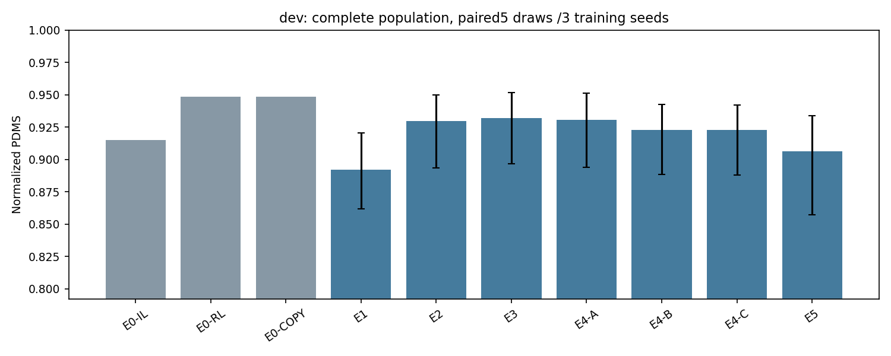

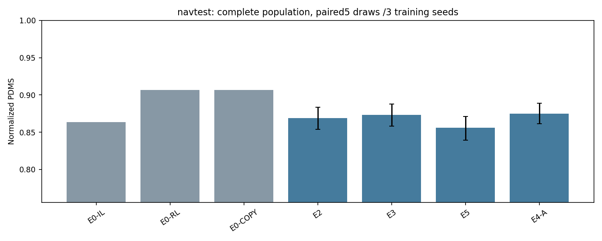

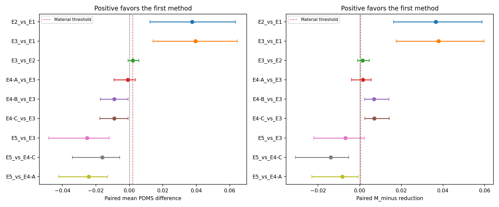

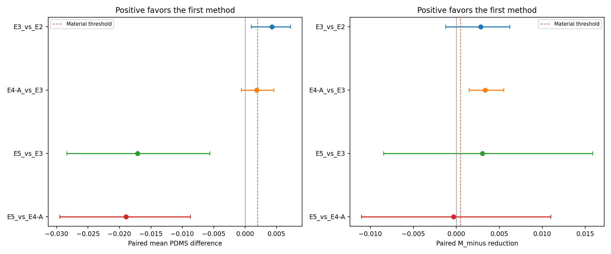

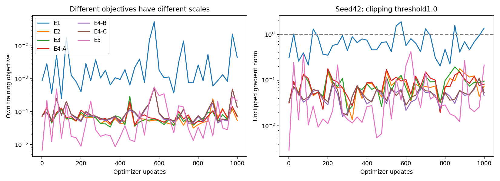

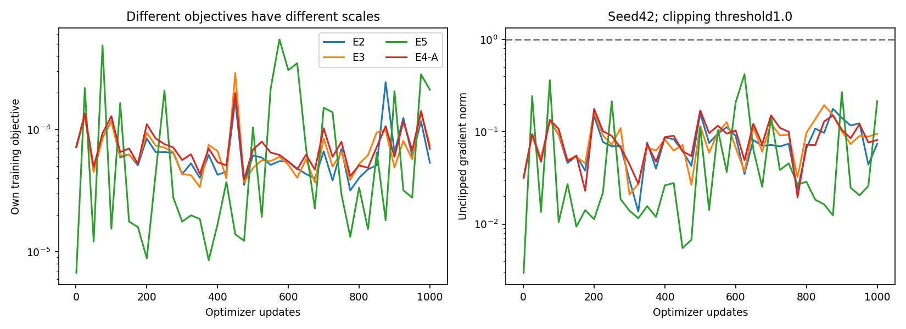

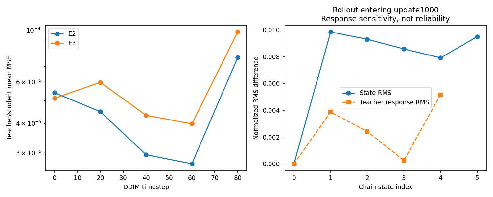

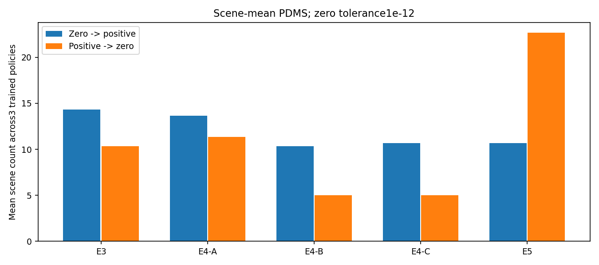

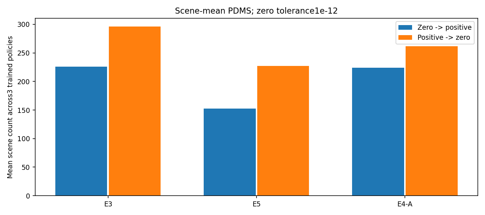

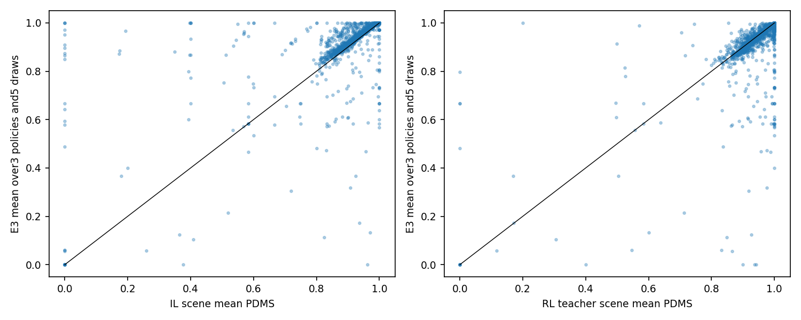

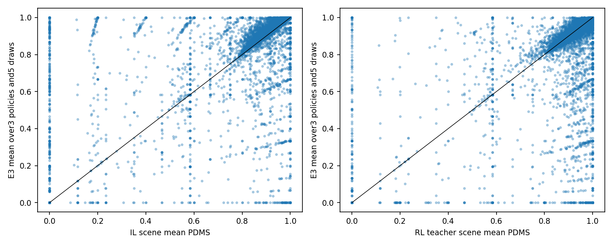

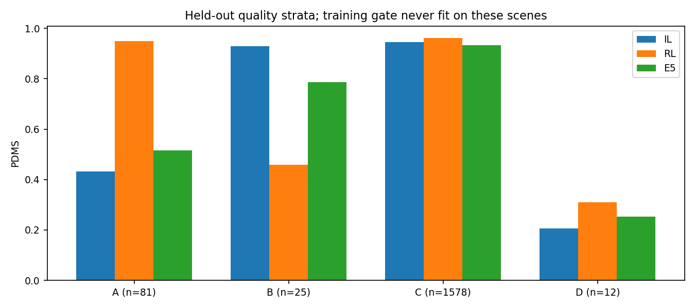

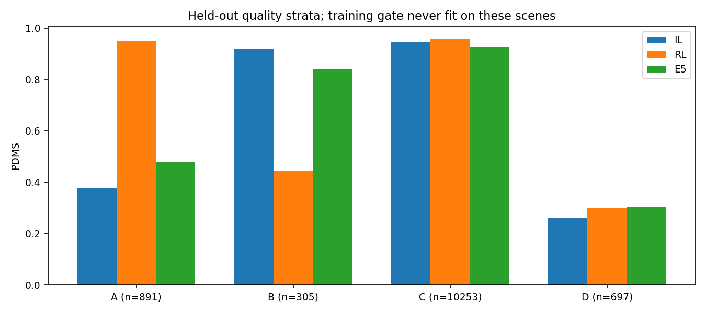

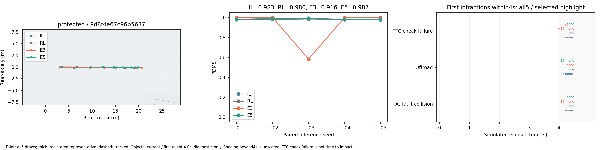

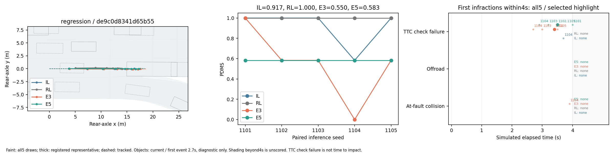

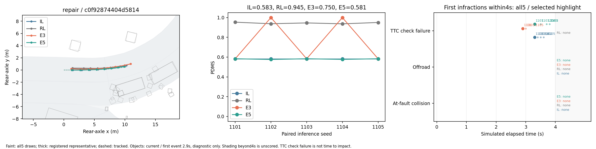

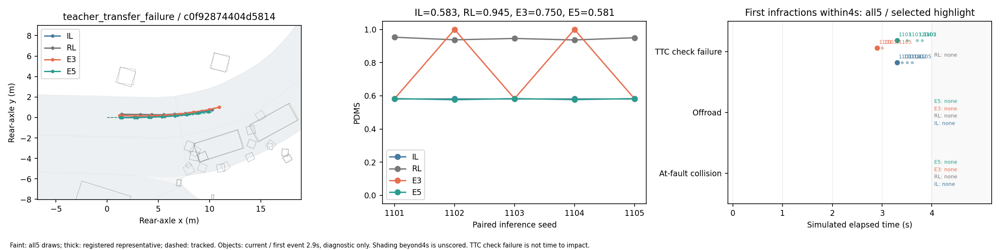

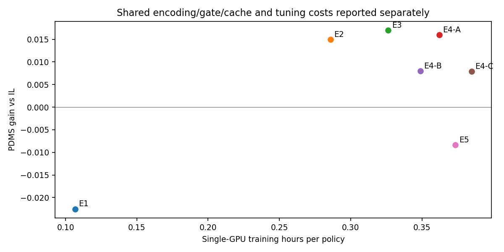

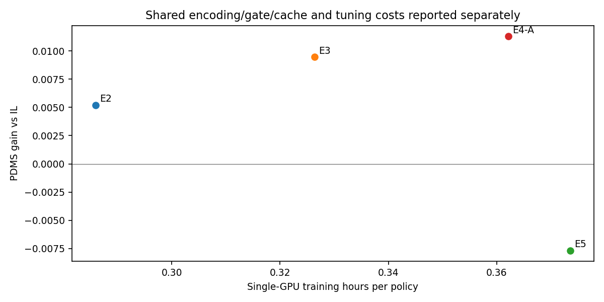

