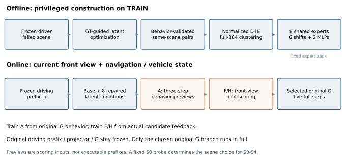

# 表征修复论文写作材料

这份材料整理了同场景反事实配对、共享表征专家、普通输入选择和迁移评价，可直接作为论文方法、结果与消融写作的起点。来源为sjc_workspace/ReCogDrive第十三批及相关前序报告，核查时间为2026-11-04T00:44:05.843672+00:00。

**先读：[分章文字](writing/01_research_story.md) → [方法与协议](writing/02_method_and_protocol.md) → [结果与消融](writing/03_results_and_ablations.md) → [论文结构](writing/04_paper_outline.md)。**

| 评价 | Base | 修复后 | 增益 |
| --- | ---: | ---: | ---: |
| 原RL / v1 PDMS | 90.4793 | 92.4074 ± 0.0064 | +1.9281 |
| IL / v2 ePDMS | 86.3003 | 90.5778 ± 0.0235 | +4.2775 |
| 续训后完整修复 PDMS | 90.4717 | 92.0021 ± 0.0249 | +1.5304 |

前三行均为三个独立训练模型的成绩平均，±为样本SD，非在线集成。另有IL/v2冻结代表的navhard两阶段26.3478→38.8995，属于单代表五动作噪声迁移。合成RL续训本身TEST为90.4717，较原Base −0.0076，不能混作修复增益。



## 材料入口

- [研究故事与发展脉络](writing/01_research_story.md)
- [完整方法、公式与训练协议](writing/02_method_and_protocol.md)
- [主表、消融、迁移及合成支线](writing/03_results_and_ablations.md)
- [论文结构、图表安排与写作边界](writing/04_paper_outline.md)
- [主张与证据强度](writing/05_claims_and_evidence.md)
- [完整HTML阅读版](paper_reading_guide.html)，下载仓库后可离线打开
- [七组可编辑图表及图注](figures/README.md)：SVG / PDF / PNG
- [CSV及LaTeX表格](tables/README.md)、[LaTeX公式](tex/method_equations.tex)
- [原始报告与协议索引](sources/README.md)、[来源路径及SHA256](sources/source_manifest.json)

## 使用口径

当前主方法是冻结驾驶模型上的运行时专家修复系统；早期教师蒸馏是历史动机与独立路线。真实评分Oracle、普通输入系统、学生参数更新结果分开。配对与聚类在普通TEST上的约+0.19分优势仍有跨零会话区间。TEST在历史研究中反复被观察，不称新盲测。IL/v1.1与大K尚未给出完成三seed的普通最终成绩，不提前进入主表。

## 复核与重建

本次从保存的逐场景结果复算156组不同的模型×人口，并做374次哈希校验；[审计摘要](sources/audit_summary.json)交代范围。包内只保留文字、汇总数据和图表，不含权重、缓存、轨迹数组、数据集或压缩大包。

```bash
python scripts/render_figures.py
python scripts/validate_package.py
```

图表仅依赖包内轻量汇总数据及NumPy/Matplotlib；原始证据路径仅用于可追溯性。HTML和Markdown均采用包内相对链接。
