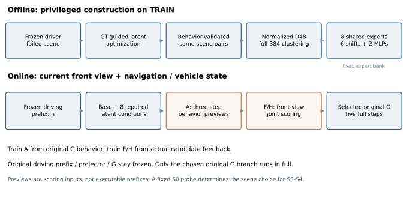
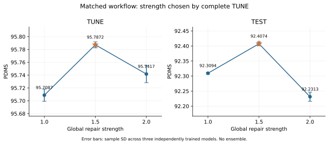
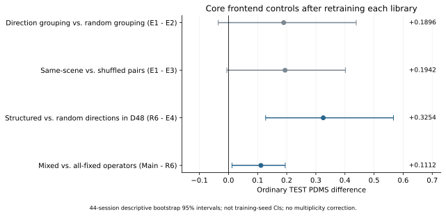
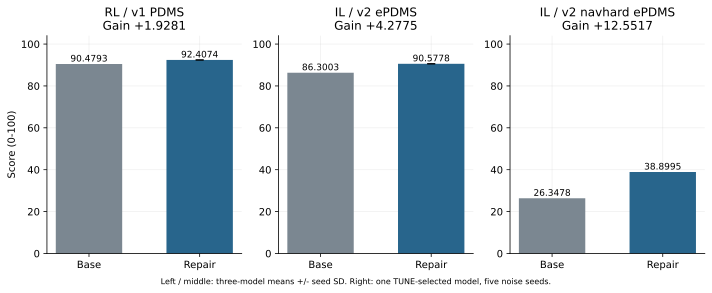
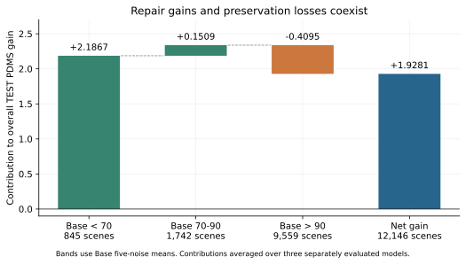
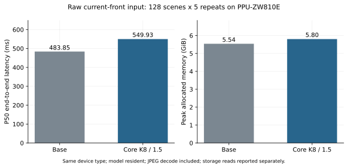
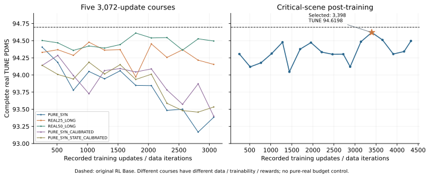

# 图表与图注

SVG保留可编辑文字，PDF适于论文排版，PNG便于预览。图上使用英文以避免字体依赖，中文图注如下。

## 方法总览



上半为训练侧特权反事实构造，下半为普通单前视部署。原驾驶模型冻结，A/FH独立训练；辅助摘要不接作最终原G前缀。

[PDF](fig01_method_pipeline.pdf) · [PNG](fig01_method_pipeline.png)

## 力度选择



同一工作流三训练seed均值与样本SD。完整TUNE选择1.5；TEST只报告。坐标范围为局部放大。

[PDF](fig02_strength_selection.pdf) · [PNG](fig02_strength_selection.png)

## 核心消融



各库自身重训后的普通TEST差异。44采集会话描述性bootstrap区间，非训练seed区间，未校正多重比较。

[PDF](fig03_core_ablations.pdf) · [PNG](fig03_core_ablations.png)

## 主结果与迁移



三个面板具有不同指标。左/中为三独立模型平均±样本SD；右为一份TUNE代表模型的五噪声两阶段迁移。

[PDF](fig04_main_results.pdf) · [PNG](fig04_main_results.png)

## 修复与保持



按Base五噪声均分分组，柱高是组内增益乘人口权重后的总体贡献。高质量组平均仍有损伤。

[PDF](fig05_repair_and_preservation.pdf) · [PNG](fig05_repair_and_preservation.png)

## 原图部署成本



PPU-ZW810E单卡，128场景×5重复；每请求含JPEG解码及所有模型路径。磁盘读取另列。

[PDF](fig06_deployment_cost.pdf) · [PNG](fig06_deployment_cost.png)

## 合成RL完整曲线



六课程78个完整真实TUNE点。前五组预算3072更新；临界课程按记录数据迭代。各课程数据/奖励/更新模块不同，不作单变量因果比较。

[PDF](fig07_synthetic_rl_curves.pdf) · [PNG](fig07_synthetic_rl_curves.png)

## 重建

```bash
python scripts/render_figures.py
```

从本写作包根目录运行；依赖Python、NumPy、Matplotlib，不需要原研究数据或模型。
