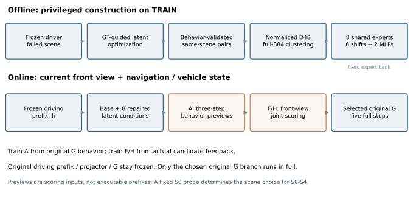

# 3．完整方法：离线构建与在线执行

## 离线：从失败中构建可复用修复

固定Base与评分协议 → TRAIN失败场景 同输入GT辅助优化 → 实际轨迹验收 失败/高质量状态配对 → 差分D48 全384维方向分组 → 共享修复算子 冻结专家库

**反事实构造。**原接口为VLM输出1536→384维线性投影，当前主库干预投影后的有效token。固定图像、导航、自车状态和原模型参数，用GT轨迹目标通过冻结动作头的去噪链更新扰动。原始GT优化的代理包括归一化XY SmoothL1和0.1倍航向余弦；PDMS由实际生成的轨迹独立评分并用于挑选，不作为可微损失。主库最终1807对来自TRAIN内1850个S0失败场景；资格为Base S0<70、优化状态实际输出S0>90。GT自身分数不替代这一资格。[GT](../sources/source_index.html#ref-GT) [LIB](../sources/source_index.html#ref-LIB) [EXP](../sources/source_index.html#ref-EXP)

早期原始搜索采用三档扰动、24步等配置，之后有逐级加强、分组token和投影前好解转移。因此当前RL主库的1807对复用了**有历史加强谱系的已验收资产**；不能简写成“全部只优化24步即可得到”。从已声明权重重训A/F/H与完整从零重新搜索全部GT端点，是两个复现层次。IL/v2和新Base分别重新定义失败和配对。[GT](../sources/source_index.html#ref-GT) [S0](../sources/source_index.html#ref-S0) [S4](../sources/source_index.html#ref-S4) [S6](../sources/source_index.html#ref-S6)

## 在线：普通输入产生选择，原G输出最终动作

当前前视 导航/车辆/运动条件 → 冻结驾驶前缀 384维token条件 → Base+8专家 9个候选内部条件 → A三步合批 候选行为摘要 → 前视F/H 联合评价9候选 → 选定条件 原G五步完整生成

原驾驶视觉、VLM、接口与最终动作头G全程冻结。A是独立动作头副本，预估各候选的行为；F/H是适配后的DrivoR评分交互模块与六分项头。部署不输入GT、高质量端点或真实评分。辅助结果只用于比较候选，选定后原G从规定噪声重新生成；不会接用辅助状态作为去噪前缀。九候选在三个辅助步骤中合批处理，因此“原动作头只执行一个分支”不代表只做了一份候选计算。[S0](../sources/source_index.html#ref-S0) [WF](../sources/source_index.html#ref-WF) [CORE](../sources/source_index.html#ref-CORE) [RUNTIME](../sources/source_index.html#ref-RUNTIME)

# 4．方法章节可采用的符号与公式

以下为对已读实现的数学整理。记有效token掩码为m，原接口状态为h∈ℝ^(L×384)，同输入高质量状态为h*，共享池化为Pool。

```text
dᵢ = Pool(hᵢ* − hᵢ)
Xᵢ = dᵢ / max(ρᵢ, ε)
B = TopRightSingularVectors₄₈(X),　BᵀB=I
uᵢ = dᵢ / ‖dᵢ‖₂，　cluster(uᵢ) ∈ {1,…,8}
```

主D空间对归一化差分做**不中心化SVD**。ρᵢ是来源实现记录的实际教师扰动RMS；RL历史库使用完整有效token扰动尺度，不能擅自替换成池化差分的RMS。ε实现为max(10⁻¹²,10⁻³×median(ρ))。聚类输入是完整384维差分的单位方向，先分组，再将簇内配对投影到共同D48；八个专家共享同一B。[GEO](../sources/source_index.html#ref-GEO) [LIB](../sources/source_index.html#ref-LIB)

簇中心修复对簇内投影差分的**单位方向**求中心，并按物理RMS尺度D₀定标，不等同于未经归一化的差分均值。条件MLP读取当前投影状态，预测输入相关修复；其配对训练还包含高质量状态上的零修复约束。主库为六个固定中心方向和两个条件MLP，不是八个各自微调的大模型，也未将它们解释为八种驾驶语义。[OPS](../sources/source_index.html#ref-OPS) [EXP](../sources/source_index.html#ref-EXP)

```text
rₖ(h) = B qₖ(Bᵀ Pool(h))
δₖ⁽λ⁾(h) = Clip_(λ bₖ)(λ rₖ(h))，　δ₀=0
hₗ⁽ᵏ⁾ = hₗ + mₗ δₖ⁽λ⁾(h)
k̂ = argmaxₖ sₖ(x, A₃(h⁽ᵏ⁾, ξ₀))
τ = G(h⁽ᵏ̂⁾, ξ)
```

此处rₖ包含专家的原生α。原主库各槽α=2、上限=2D₀；批13再整体比较λ=1/1.5/2，同时缩放请求和上限，MLP输出保留自身幅度。固定λ由TUNE选择，不在TEST逐场景搜力度，也不混成27候选。Padding不编辑。选择k̂只读取普通输入与固定S0探测噪声ξ₀，同一场景的S0—S4执行均用该选择。[PLAN](../sources/source_index.html#ref-PLAN) [EXP](../sources/source_index.html#ref-EXP) [S2](../sources/source_index.html#ref-S2) [CORE](../sources/source_index.html#ref-CORE)

## 辅助行为与选择器的目标

```text
L_(A) = 16 · Mean₍场景,候选,坐标₎ ‖A₃的最终去噪状态 − 原G在S0的最终状态‖²
L_(F/H) = 六分项BCE + 按真实PDMS分差加权的候选两两排序损失
```

A不是GT轨迹模仿器：它拟合冻结原G在各专家条件下的真实行为。F/H则用各候选实际五噪声平均分项与PDMS差监督，最终以完整TUNE的真实总分选轮次。六头为NC、DAC、TTC、进度、行驶方向合规和舒适性。[ATRAIN](../sources/source_index.html#ref-ATRAIN) [FTRAIN](../sources/source_index.html#ref-FTRAIN) [FSCORE](../sources/source_index.html#ref-FSCORE)

**v1评分代理与真实PDMS应怎样区分**

实现中的排序分数为log pNC + log pDAC + log(5pTTC+5p进度+2p舒适性) − log 12；行驶方向头有分项监督，但未直接进入该v1排序标量。这只是学习评分代理；最终成绩来自实际原G轨迹的官方评分，不能把六个头的预测组合称为精确可微PDMS。IL/v2另用固定组合并在最终评价中完整计算跨帧EC。

# 5．训练起点、预算与数据协议

| 部分 | 初始化与更新 | 数据与预算 |
| --- | --- | --- |
| 原驾驶模型 | ReCogDrive-2B-RL；修复流程内全部冻结。 | 基模SHA256前缀23fb949b10387efe；IL/v2换用其自己的IL检查点。 |
| 共享专家 | TRAIN同输入配对；D48、K8，6中心+2MLP。 | 1807个合格配对，配对覆盖120会话；拟合/校准参考人口覆盖130会话。 |
| 辅助A | 复制原G，噪声适配零初始化；33,742,467个参与前向的可训练参数。 | 固定自然TRAIN 32,768场景；4轮、global batch32、lr=1e−5；E1/E3重置优化器，两轮一段余弦。 |
| 前视F/H | 原生DrivoR发布权重；更新交互与六头，约5,800,966参数；视觉、轨迹和车辆编码冻结。 | 完整TRAIN 85,813场景；4轮、batch64；交互lr=1e−5，头lr=3e−5。 |
| 权重与配方选择 | A取预定E4；F/H从E0—E4按完整TUNE选择。 | 力度按三训练seed的TUNE均值；代表seed也由TUNE选，未取TEST最高seed。 |

[INIT](../sources/source_index.html#ref-INIT) [EXP](../sources/source_index.html#ref-EXP) [WF](../sources/source_index.html#ref-WF) [ATRAIN](../sources/source_index.html#ref-ATRAIN) [FTRAIN](../sources/source_index.html#ref-FTRAIN) [MAIN](../sources/source_index.html#ref-MAIN)

| 固定人口 | 场景数 | 采集会话数 | 用途 |
| --- | --- | --- | --- |
| TRAIN | 85,813 | 130 | 配对、构库、A/FH训练和训练侧回测 |
| TUNE | 17,475 | 32 | 课程/力度/主权重选择 |
| TEST | 12,146 | 44 | 报告普通结果与机制对照 |

三人口按采集会话隔离；teacher32完全属于TRAIN。上述为该项目实际验收的人口，不凭名字推断其他NAVSIM划分或全量人数。早期GT逐场景优化曾覆盖包含TUNE的完整navtrain诊断；当前主专家拟合仅消费TRAIN的1807对，不能把全部2288个GT诊断样本都写成训练配对。[SPLIT](../sources/source_index.html#ref-SPLIT) [GT](../sources/source_index.html#ref-GT) [S0](../sources/source_index.html#ref-S0)

**统计与输入声明：**S0—S4是动作采样噪声，不是五个训练seed；20261026/27/28才是三次独立A/FH训练。均值不是上线集成，±是训练种子样本SD，不是置信区间。TEST在历史研究中反复被观察，当前验证选模流程不会使其重新成为未触碰盲测。本批新增训练使用真实数据；基础模型与DrivoR的全部预训练来源未在本批重新审计。[S0](../sources/source_index.html#ref-S0) [S1](../sources/source_index.html#ref-S1) [S2](../sources/source_index.html#ref-S2)



LaTeX公式见[method_equations.tex](../tex/method_equations.tex)。
