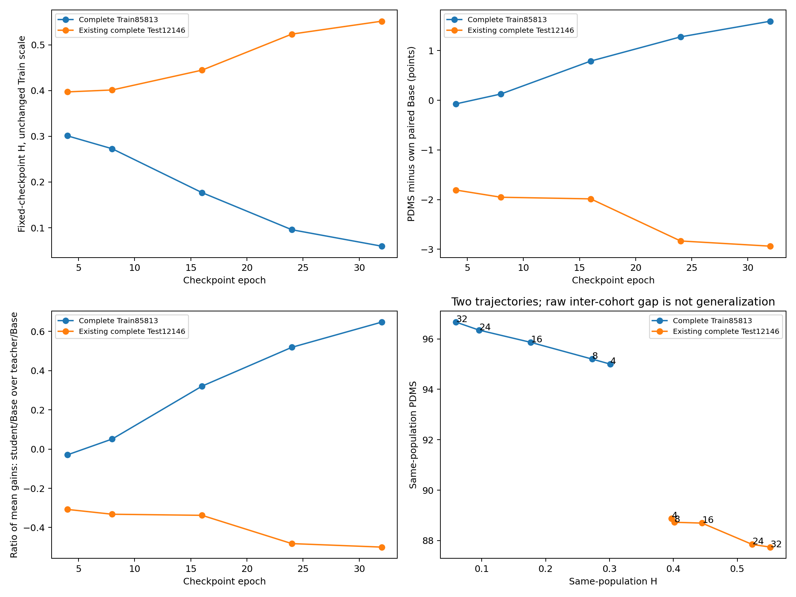

# 本轮蒸馏已停止：完整 Train/Test 结果与清理归档

2026-10-28 15:06:51 UTC，用户要求停止的训练、评测和控制器已全部实际退出，五台服务器本项目在跑进程为零，自动恢复与后续调度已禁止。15:12:10 UTC 完成清理。A 组训练已完整到 40 epoch；B/C/D 最后完整 epoch 为 32/23/21，未完成的原 40 epoch 预算已取消。本归档不将它们标为完成。

A 组全部 1,106 个文件均保留且元信息核验未变，其中 97 份 checkpoint 经 SHA256 核验未变。B/C/D 保留全部已完成 Test 关联权重及各 run 最后完整 epoch，共 12 份；删除其余 177 个中间 `.pt`，释放逻辑字节 4,409,115,022（4.106308 GiB）。原数据、教师、Base、缓存、日志、metadata、逐场景结果和报告全部保留。`last.pt` 重复副本删除后对应 canonical epoch 权重仍保留，替代路径记录在 KEEP 中。

## A：完整 Train 85,813 与完整 Test 12,146

固定 A/H_full seed20261027 的 epoch4/8/16/24/32，每点均为完整人群及同场景 S0–S4；H 每场景计算一次。Train 每点复用旧 8,192 条完整记录，真实新算余下 77,621 条，逐 token 合并为 85,813 条。Test 全部复用已完成完整结果，没有新增 Test 推理/评分。

- [完整报告](A_full_train/FULL_TRAIN_H_PDMS_GENERALIZATION_REPORT.md)
- [每个 checkpoint 的精确成绩与 H](A_full_train/CHECKPOINT_CURVES.csv)
- [Pearson/Spearman 相关性表](A_full_train/CORRELATIONS.csv)
- [相邻同场景差分及 log 聚类区间](A_full_train/ADJACENT_DIFFERENCES.csv)
- [保持组/修复组和严重退化](A_full_train/KEEP_REPAIR_CURVES.csv)
- [端点 95% log 聚类区间](A_full_train/ENDPOINT_EVIDENCE.json)
- [全量与旧 8,192 面板的实际差异](A_full_train/PANEL_REPRESENTATIVENESS.csv)
- [完整聚合统计 JSON](A_full_train/SUMMARY.json)

Train H 从 0.301131 降至 0.059741，PDMS 从 94.9994 升至 96.6635；epoch32 相对自己的 Base 提升 1.5915 点，保留教师收益 64.75%。五个 checkpoint 均值的 H–PDMS Pearson=-0.999245、Spearman=-1。

Test H 从 0.397157 升至 0.551774，PDMS 从 88.8716 降至 87.7419；epoch32 相对自己的 Base 为 -2.9373 点。Test 均值 H–PDMS Pearson=-0.977338、Spearman=-1。训练数据上的 H 下降确实伴随行为均分改善，但收益没有转移到 Test；不能笼统说 loss 与 PDMS 无关，也不能由此宣称逐场景必然相关。

这些是一个训练 seed 的五个相关 checkpoint，不是五个独立训练。Test 已参与模型选择，不是独立 holdout。比较迁移使用各自配对 Base 的收益与保持组退化，不使用原始 Train/Test 分数差直接命名泛化差距。全量相对旧面板的 PDMS 最大绝对差仅为这五点上的 0.0977 点，不据此声称面板对任意模型无偏。

## B/C/D：已完成结果与停止边界

[完整 Test 与在线/固定 loss 简表](BCD_snapshot/RESULTS.md) · [精确 CSV](BCD_snapshot/TEST_SCORES_AND_LOSS.csv) · [停止状态与在线 loss JSON](BCD_snapshot/RESULTS.json)。B32 Test 为停止时的 partial，不报告完整均分；所有负结果保留。B/C/D 目标为 gain1，A 为 full；B/C/D 未做本次完整 Train 联合行为/H 分析。

## 来源、成本与保留范围

[完整计算完成收据](provenance/COMPLETE.json)、[独立原始逐行数值核查](provenance/INDEPENDENT_FULL_NUMERIC_REVIEW.json)、[实测成本](provenance/MEASURED_GPU_COSTS.json)、[原文件 SHA](provenance/ORIGINAL_SOURCE_IDENTITIES.json)、[全 Train/Test 来源](A_full_train/SOURCE_PROVENANCE.json)。本次补全 Train 共使用 40 个物理 GPU，新增推理/评分执行跨度约 71.61 分钟；并发进程寿命和各 GPU 预留 wall union 分开报告，不把它们当精确 GPU kernel 时间。

[实际停止](stop_cleanup/STOP_COMPLETE.json) · [实际清理](stop_cleanup/CLEANUP_COMPLETE.json) · [A 全量保护核验](stop_cleanup/A_PROTECTED_AFTER.json) · [保留权重路径/SHA/last 替代](stop_cleanup/inventory/KEEP.json)。这些路径是本机溯源，不意味着大权重已经上传。

本提交只含聚合表格、JSON、报告、PNG 和 compact 收据，没有上传权重、大数组、原始轨迹或数据集。原逐场景 CSV、完整分片和逐行 protocol/SHA 仍在本机原目录，详见来源记录。原始完整报告中列出的逐场景文件名指本机产物；本目录中的文件清单以 PUBLICATION_MANIFEST.json 为准。
