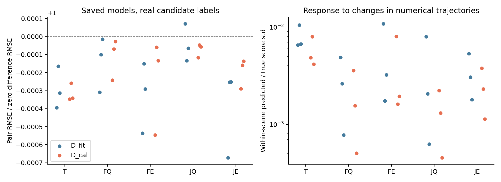

# 已保存后果预测器的继续复核

本次继续工作对已保存的15个正式模型执行真实前向与反向复核，没有新增优化器更新、评分真值或审计集前向。原[主报告](REPORT_zh.md)、锁定协议、正式统计结果和研究判断均通过内容哈希验证保持不变。

## 复核结果

- 完成5组×3种子×128场景，共1920个场景—模型组合；每个模型另对两个固定场景分别计算绝对值项与差值项梯度。15组全部通过。
- 原保存的基准Q和真实更新差值重放最大误差为 **0**。从原逐轨迹分数重建的真实更新标签逐元素一致。
- 损失与独立NumPy公式的最大误差为 **8.99503342e-08**；将候选全部替换成同一数值轨迹后，候选间输出差异为0。
- 30个反向检查的轨迹查询分支差值梯度均非零，范数范围 **7.45141e-05–0.00552007**。联合组12次VLM差值梯度也均非零，范数范围 **1.19182e-05–0.00527425**。普通Q组的这次差值梯度仅作诊断，没有用于训练。
- 联合组12次零LoRA对照的原生特征与冻结缓存最大误差为0；加载已训练LoRA后，特征最大变化为 **64.625–115.875**，同噪声动作的xy RMS变化为 **0.297104–0.638681 米**。因此训练确实改变了动作生成共享的VLM路径。
- 每个检查点文件哈希与头参数在复核前后均保持一致。复核用的是固定的已训练模型。

## 近零预测的含义

确认训练库共有143,740个fit候选、41,440个cal候选；同场景候选对中，真实分差绝对值超过0.02的比例分别为 **12.747%** 和 **14.340%**。标签并非全部相同。

下表使用复核前固定的64个fit场景和64个cal场景，对三个训练种子取描述性平均。“常数Q”只使用完整D_fit候选的平均标签；“零差值”恒预测0。响应比例先在每个场景内中心化候选分数，再计算预测与真值标准差之比。

| 用途 | 组别 | 绝对Q RMSE / 常数Q RMSE | 候选对差值RMSE / 零差值RMSE | 同场景响应比例 |
|---|---|---|---|---|
| D_fit | T | 0.184250 / 0.183926 | 0.108477 / 0.108508 | 0.793% |
| D_fit | FQ | 0.182539 / 0.183926 | 0.108493 / 0.108508 | 0.276% |
| D_fit | FE | 0.182281 / 0.183926 | 0.108473 / 0.108508 | 0.528% |
| D_fit | JQ | 0.181798 / 0.183926 | 0.108504 / 0.108508 | 0.356% |
| D_fit | JE | 0.181592 / 0.183926 | 0.108466 / 0.108508 | 0.341% |
| D_cal | T | 0.198797 / 0.200653 | 0.138486 / 0.138529 | 0.566% |
| D_cal | FQ | 0.192918 / 0.200653 | 0.138514 / 0.138529 | 0.188% |
| D_cal | FE | 0.192584 / 0.200653 | 0.138495 / 0.138529 | 0.386% |
| D_cal | JQ | 0.192484 / 0.200653 | 0.138519 / 0.138529 | 0.133% |
| D_cal | JE | 0.192477 / 0.200653 | 0.138502 / 0.138529 | 0.241% |



模型对数值轨迹变化的响应很弱，而标签具有明显的候选差异。非零梯度和参数变化说明计算路径连通；它们不能证明模型已学会辨识后果。本次没有发现足以要求作废原结果的标签、保存、损失或共享特征错误。也没有验证导致学习失败的唯一原因，容量、优化和监督分布的作用尚未被区分。

原H2的 `NOT_SUPPORTED` 仅表示本次固定读出头、LoRA范围、数据和预算没有取得预注册的实质改善。不能据此声称VLM中不存在所需信息，或所有后果学习路线都无效。

## 结论与执行边界

H1维持 `SUPPORTED`，H2维持 `NOT_SUPPORTED`，H3维持 `INCONCLUSIVE`。阶段B/D停止条件没有改变，未启动RL-Q/RL-E训练或navtest。继续扩大当前差值损失路线缺少支持；本次复核完成后停止该路线。

这是查看正式结果后的数值复核，不是新增确认实验；表中没有置信区间，也未用于调参或选择检查点。场景集合按token哈希从既有D_fit/D_cal评价目标中各取64个；梯度检查按预先记录的规则在每个集合内选标签跨度最大的一个场景。未访问新的审计输入，未更换研究起点。

使用4台获准服务器的空闲GPU并行重放，新增占用 **0.1616 GPU小时**。原研究成本记录保持原样；本次成本和各命令另存 [复核运行记录](/mnt/project/VLA-AD/outputs/trajectory_effect_validation_20261019/review_20261019/accounting.json)。

## 记录与复现

- 复核前固定的[注册记录](review_registration.json)，SHA256 `5ec989c2618dc7d85c66ba56d35753557889dc0b31b0e535ae09329e03ba5c0b`。
- 原锁定协议SHA256 `7177a32ff6fa1c0a78161f4e6aa1ebdd126796796330a3c1d47a1270710be6a7`；报告生成代码 `0d106a66273d87d88693b07c9605c9809f081f7d`；各实际进程使用的代码版本见运行记录。
- [逐模型汇总](review_summary.json)；逐场景预测、标签、梯度和共享动作变化：`/mnt/project/VLA-AD/outputs/trajectory_effect_validation_20261019/review_20261019`。
- 研究分支：`research/trajectory-effect-validation-20261019`。

以下是真实执行入口；register和replay拒绝覆盖已完成记录。完整的15个replay命令及其host/GPU分配保存在运行记录，重放只需相应空闲GPU。

```bash
cd /mnt/project/VLA-AD/research/trajectory-effect-validation-20261019
/root/miniconda3/envs/navsim/bin/python -m tools.trajectory_effect.review register
/root/miniconda3/envs/navsim/bin/python -m tools.trajectory_effect.review offline
CUDA_VISIBLE_DEVICES=0 /root/miniconda3/envs/navsim/bin/python -m tools.trajectory_effect.review replay --arm FQ --seed 42
# 其余arm=T/FQ/FE/JQ/JE，seed=42/43/44；每个组合执行一次。
/root/miniconda3/envs/navsim/bin/python -m tools.trajectory_effect.review summarize
/root/miniconda3/envs/navsim/bin/python -m tools.trajectory_effect.review_report
```
