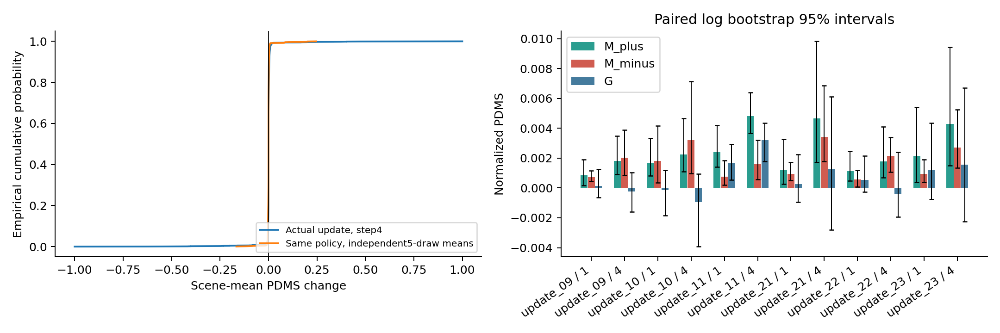
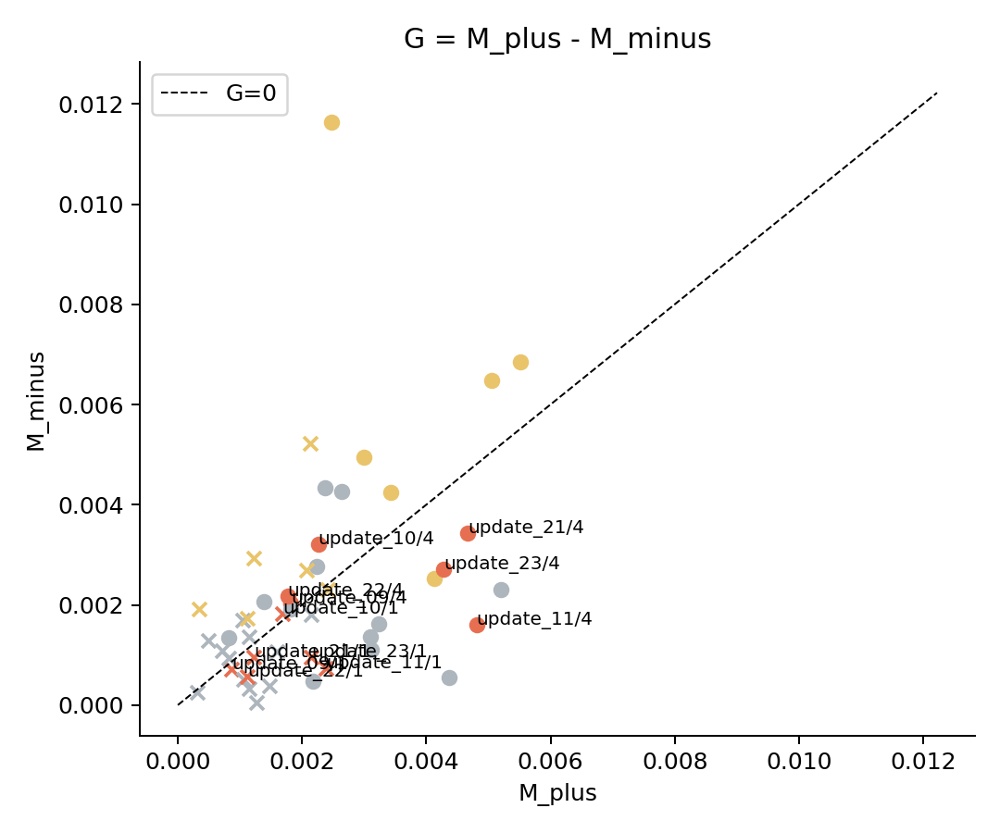
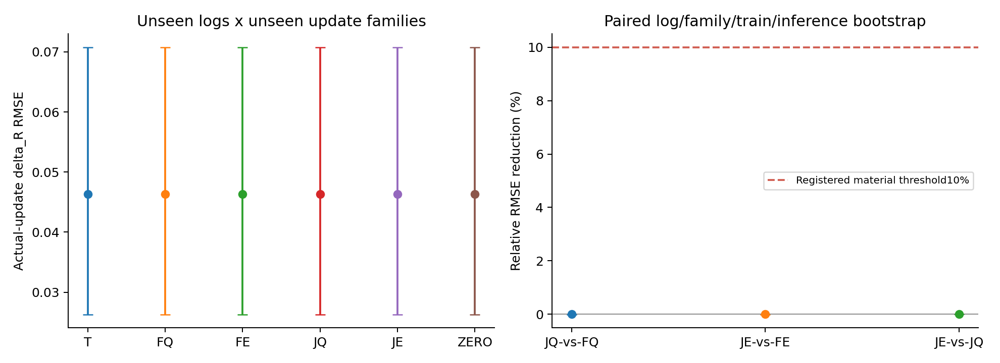
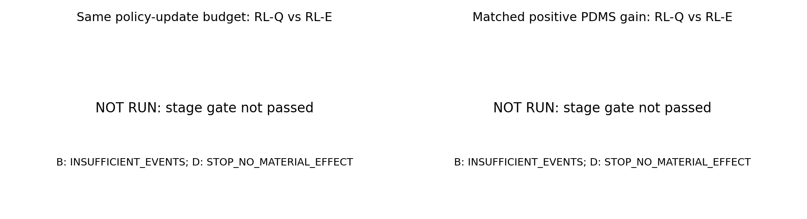
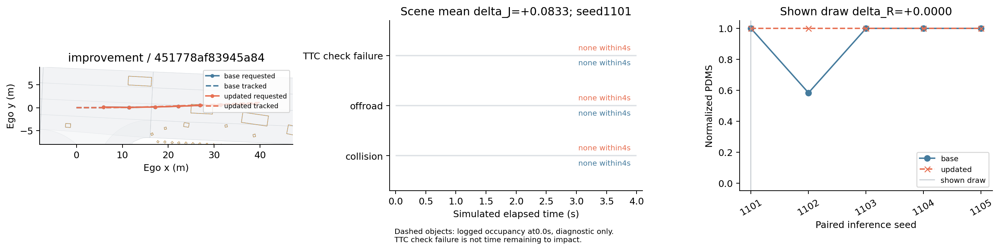
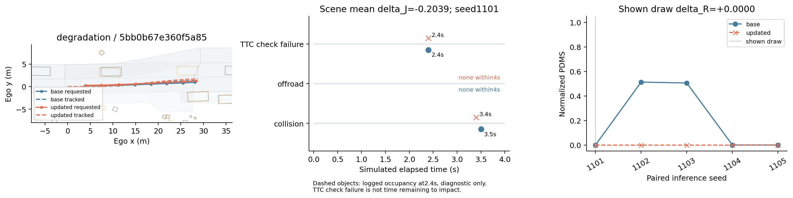
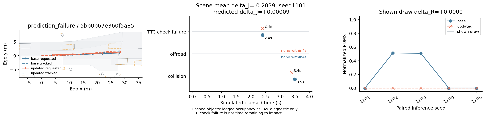

# 连续轨迹后果辨识与 ReCogDrive 跨场景退化验证

本报告只依据本次真实运行结果。全部分数使用 `[0,1]` 的 NAVSIM v1.1 PDMS；乘以100才是百分制分数点。数据和模型的适用范围、阶段停止以及未完成的假设检验分别列明。

## 研究结论

| 假设 | 判断 | 证据与限制 |
|---|---|---|
| H1 | `SUPPORTED` | 同一真实更新族 update_11 的总体增益区间高于0，同时独立25种子确认的严重下降子集仍为负；支持跨场景得失共存。 |
| H2 | `NOT_SUPPORTED` | JQ/FQ的RMSE相对降低-0.002%，JE/FE为-0.001%；JE/JQ为0.003%。差值监督的10%实质收益判断为NOT_SUPPORTED。 |
| H3 | `INCONCLUSIVE` | 阶段B=INSUFFICIENT_EVENTS，阶段D=STOP_NO_MATERIAL_EFFECT；按锁定停止规则未启动500步RL对照，H3未被检验。 |

建议：停止继续扩大当前差值辅助监督路线；保留真实退化和后果数据作为诊断资产。未验证的RL效果不能写成已被改善。

## 实际实验与身份

实际完成24个独立更新族、共96次原生 GRPO 优化器更新，每族保存0/1/4步。12个初始族加一次预注册的12族确认扩容；自然分布与低分且奖励有差异的来源都保留。所有分支共享同一初始策略参数哈希，零更新最大误差均为0；没有接续累积不同更新族。

预测实验完成15个校准运行（每个300步）以及五组×三个训练种子×2000步的正式训练。每个训练种子的首次输入及损失在 FQ/FE/JQ/JE 间完全一致，见 [初始化核验](/mnt/project/VLA-AD/outputs/trajectory_effect_validation_20261019/analysis/probe_identity_audit.json)。全局批次4、单场景微批次1；不同并行度只分摊微批次并对全局样本均值求梯度。RL正式阶段状态为 `NOT_RUN_GATE`，具体理由见下文。

- 研究分支：`research/trajectory-effect-validation-20261019`；报告生成时代码：`bed1997c81a5b38c57e62f8e779b8dc45910bde3`。
- 实际主起点：`/mnt/project/VLA-AD/checkpoints/recogdrive/ReCogDrive-2B-RL/ReCogDrive_Diffusion_Planner_2B_RL.ckpt`，SHA256 `23fb949b10387efeff87e093703d5faf41b61b9e5ead16d4076661e3c7c08a20`，epoch24/global_step8325。
- VLM：`/mnt/project/VLA-AD/checkpoints/recogdrive/ReCogDrive-VLM-2B`，SHA256 `79fb39297e322cd2d3dc68d4f23b86ff85806b336a4d5d0ed5db9b66e4034a3c`。
- 原始仓库代码：`884ea1d0f67c60821d61033d61efb10916d16929`；每个运行还有实际 commit、源码内容哈希、服务器、GPU、PID/start-time 和命令记录。
- [锁定协议](../../configs/trajectory_effect_validation_20261019/protocol.yaml)，SHA256 `7177a32ff6fa1c0a78161f4e6aa1ebdd126796796330a3c1d47a1270710be6a7`。没有把本轮重新初始化 AdamW 的训练称为历史更新复现。
- 评分器、仿真器、缓存类型与基线身份见 [source_weights.json](/mnt/project/VLA-AD/outputs/trajectory_effect_validation_20261019/manifests/source_weights.json)；实际选用日志、图像和缓存的内容身份见 [input_content_identity.json](/mnt/project/VLA-AD/outputs/trajectory_effect_validation_20261019/manifests/input_content_identity.json)。原文件修改时间均早于协议锁定。

主干是发布版 InternVL/Qwen2 2B VLM，动作头是原有 small LightningDiT，五步 DDIM 输出8×3轨迹（0.5–4秒，当前自车后轴坐标，x前/y左/heading弧度）。完整轨迹是联合动作。输入只含推理可见的当前前视图、四帧自车历史、状态和指令。读取的是动作头实际接收的完整VLM token，没有 teacher-forced 答案或真实未来。

基准策略在本次审计集的五种子平均PDMS为0.9479255933（94.79256百分制分数点）。24族训练共768个实际采样组，其中9组奖励无差异；这些组和原生BC项均保留并记录，没有伪造advantage。

联合更新范围锁定为28层语言注意力 Q/V 的 rank8、alpha16 LoRA，共1,089,536个参数；图像编码器及底座参数冻结。统一条件轨迹读出头为两层跨注意力、192维、六头，共1,270,465个参数。结论限定于该可训练范围和本次预算，不外推为全参数 VLM 的能力上限。

## 划分与信息边界

| 用途 | 场景 | 完整log | 上级驾驶记录 | 清单SHA256 |
|---|---:|---:|---:|---|
| D_fit | 4115 | 50 | 44 | `e3292aae30586c02e6c0df62639a0dd3e9bfc58b55a6c5662ec4654e0bfaee1f` |
| D_cal | 518 | 4 | 4 | `10488343ac654799c109e80bf09d26da6b49e4fc4210e7e3dba53c13c87a82c3` |
| D_audit | 1696 | 16 | 15 | `f9552d196d8973a6cfd1f182702b777198012f9fe60d51acee08c039e75eea53` |

目标log、场景及上级驾驶记录互斥。新增更新族按12/6/6分别用于fit/cal/audit；同族的1/4步不跨用途。主要预测结果是1696个保留场景、16个log与6个保留更新族的交叉组合。校准仅4个log，因此选择本身存在不确定性。

这些数据均来自官方 navtrain，可能被底模预训练见过；“保留”仅指没有用于本次新增训练。官方 navtest 未用于调参、选阈值或选检查点。本轮未通过进入最终确认的开发门槛，未执行官方测试集确认。

真实PDMS、未来占用、碰撞事件、候选来源及场景/更新编号均不进入主预测器输入。T只使用数值轨迹和可观测自车状态/指令；附加线性对照使用真实基线PDMS，明确属于评价标签 privileged 诊断。真实未来占用仅在案例图中解释后果，没有作为任何主预测器特征。

## 阶段A：评分与配对有效性

64个真实场景、1024条轨迹经过正式逐候选入口、批量包装、顺序和分批比较。原始多候选直接评分存在候选集合依赖，归一化总分最大差为0.309478303825；修正包装层后与正式reference/candidate逐对口径的最大差为0，离散分项完全一致。正式评分器未修改。该检查与 [NAVSIM v1.1正式入口](https://github.com/autonomousvision/navsim/blob/v1.1/navsim/evaluate/pdm_score.py) 的reference/candidate语义一致，具体执行以本地源码哈希为准。

同一观测、模型和噪声的轨迹误差、重复评分误差、零更新分数差均为0。小测还执行了真实GRPO反向与参数更新，以及共享VLM辅助监督反向；这两项仅用于运行资格验证，不是H1/H2/H3成功证据。

原有RL训练奖励的进度/TTC/舒适度权重为10/5/2；正式PDMS端点和后果标签为5/5/2。本轮保持原生RL目标和采样器，明确保留这个项目现有差别。策略各自从自身当前policy生成真实采样链，未把人工扰动或其他策略轨迹冒充on-policy动作。

## H1：真实更新、自然采样波动与确认

先按场景平均五个配对推理种子，再计算G、M_plus和M_minus。以下区间联合重采样完整log、更新族和推理种子；相邻检查点保持同族相关性。

| 更新步 | G，95%区间 | M_plus，95%区间 | M_minus，95%区间 | 明显下降比例，95%区间 |
|---:|---|---|---|---|
| 1 | 0.000611 [-0.000274, 0.001960] | 0.001572 [0.000625, 0.003323] | 0.000961 [0.000457, 0.001983] | 0.004226 [0.001030, 0.006719] |
| 4 | 0.000740 [-0.001049, 0.003037] | 0.003266 [0.001576, 0.006526] | 0.002526 [0.001382, 0.004548] | 0.008058 [0.003381, 0.012767] |

| 审计族，步骤4 | 来源 | G，95%区间 | M_minus，95%区间 | 明显下降场景 / 所在log |
|---|---|---|---|---:|
| update_09 | low_score_reward_diverse | -0.000223 [-0.001590, 0.001029] | 0.002037 [0.000852, 0.003901] | 12 / 6 |
| update_10 | natural | -0.000961 [-0.003929, 0.000948] | 0.003219 [0.000974, 0.007149] | 14 / 6 |
| update_11 | low_score_reward_diverse | 0.003214 [0.001775, 0.004337] | 0.001595 [0.000566, 0.003217] | 17 / 9 |
| update_21 | low_score_reward_diverse | 0.001243 [-0.002808, 0.006115] | 0.003424 [0.001788, 0.006874] | 15 / 8 |
| update_22 | natural | -0.000399 [-0.001951, 0.002410] | 0.002167 [0.001073, 0.003376] | 7 / 4 |
| update_23 | low_score_reward_diverse | 0.001567 [-0.002262, 0.006710] | 0.002713 [0.001339, 0.005253] | 17 / 8 |

同一模型的两组独立五次采样自比较及完整连续变化见 [h1.json](/mnt/project/VLA-AD/outputs/trajectory_effect_validation_20261019/analysis/h1.json)。单次输出的下降概率另列在文件中，没有替代场景平均下降幅度。独立筛选种子定义了1422个稳定高分场景，其评价采用另一组种子，结果见 [stable_high.json](/mnt/project/VLA-AD/outputs/trajectory_effect_validation_20261019/analysis/stable_high.json)。新增碰撞、越界、TTC、舒适度、方向违规及正分到零分的数量逐族保留。





初始5次采样仅用于选择预注册的严重下降子集；下面是额外25组独立成对种子的确认结果。该子集按log分层、哈希选取，不能作为总体发生率。

| 更新族 | 复核场景 | 步骤4仍下降超过0.02 | 仍下降超过0.10 | 子集步骤4平均变化，95%区间 |
|---|---:|---:|---:|---|
| update_09 | 8 | 8 | 4 | -0.170235 [-0.275715, -0.053784] |
| update_10 | 12 | 11 | 10 | -0.376146 [-0.505462, -0.205235] |
| update_11 | 9 | 8 | 6 | -0.178401 [-0.274807, -0.086102] |
| update_21 | 13 | 12 | 11 | -0.341916 [-0.440223, -0.245155] |
| update_22 | 6 | 5 | 5 | -0.225717 [-0.318153, -0.125551] |
| update_23 | 14 | 13 | 10 | -0.254927 [-0.347744, -0.177753] |

阶段B的操作门槛为至少两个保留族各有20个明显下降场景、涉及至少4个log；实际状态为 `INSUFFICIENT_EVENTS`。存在真实负向后果与满足后续有效比较所需事件数量是两个不同判断。唯一一次确认扩容已经使用，未再扩大训练或降低门槛。

## H2：表征与监督目标的独立归因

每场景新增候选15条：4条自身额外采样、1条发布版IL轨迹、10条平滑数值扰动；基准与真实更新轨迹另存。扰动尺度在fit/cal真实更新上锁定，纵向中位/90分位RMS为0.142278/0.301767米，横向为0.052330/0.099886米；没有依据审计失效位置调探针。碰撞、越界、低分及跟踪差异均保留。

候选按完整轨迹数值去重并保留全部来源，每场景至多32个固定分层轨迹对。绝对值项和差值项分别按样本数取均值；普通Q与差值监督使用相同真实标签。数据覆盖与小扰动掉分见 [candidate_coverage.json](/mnt/project/VLA-AD/outputs/trajectory_effect_validation_20261019/analysis/candidate_coverage.json)。人工扰动的反向后果不被当作真实参数更新退化的证明。

全部94,935条新增候选还保留了逐轨迹连续跟踪误差，见 [candidate_tracking.npz](/mnt/project/VLA-AD/outputs/trajectory_effect_validation_20261019/analysis/candidate_tracking.npz)。未找到环境定义的“跟踪失败”阈值，因此没有新增事后分类阈值；不因误差、碰撞或越界删除监督。

| 组别 | 校准后head学习率 | lambda_diff |
|---|---:|---:|
| T | 0.001 | 1.0 |
| FQ | 0.0003 | 0.0 |
| JQ | 0.0003 | 0.0 |
| FE | 0.0003 | 1.0 |
| JE | 0.0003 | 1.0 |

校准选择在一次小范围比较后锁定；确认扩容没有重新选择。正式模型各从共同底座重新初始化，没有把校准或诊断中联合训练的权重单独用于其他组。

| 组别 | 回报差MAE，95%区间 | 回报差RMSE，95%区间 | 退化PR-AUC（AP），95%区间 | 前10%审查召回，95%区间 |
|---|---|---|---|---|
| T | 0.004211 [0.002347, 0.007623] | 0.046301 [0.026285, 0.070766] | 0.005214 [0.001883, 0.009172] | 0.071632 [0.000000, 0.184424] |
| FQ | 0.004203 [0.002334, 0.007625] | 0.046303 [0.026291, 0.070768] | 0.005579 [0.001966, 0.012040] | 0.094970 [0.000000, 0.209551] |
| FE | 0.004199 [0.002334, 0.007619] | 0.046302 [0.026290, 0.070766] | 0.005034 [0.001907, 0.008657] | 0.084598 [0.000000, 0.191932] |
| JQ | 0.004217 [0.002361, 0.007642] | 0.046304 [0.026291, 0.070769] | 0.004900 [0.001895, 0.009031] | 0.103645 [0.000000, 0.232905] |
| JE | 0.004202 [0.002335, 0.007620] | 0.046303 [0.026290, 0.070767] | 0.005139 [0.001849, 0.009964] | 0.063368 [0.000000, 0.155575] |
| ZERO | 0.004204 [0.002334, 0.007637] | 0.046305 [0.026293, 0.070771] | 0.006141902515723271 | 0.06473895113600996 |

| 归因对照 | RMSE相对降低，95%区间 |
|---|---|
| JQ-vs-FQ | -0.00212 [-0.00922, 0.00040]% |
| JE-vs-FE | -0.00105 [-0.00661, 0.00238]% |
| JE-vs-JQ | 0.00327 [-0.00059, 0.01009]% |
| FE-vs-FQ | 0.00220 [-0.00180, 0.00785]% |
| JE-vs-T | -0.00363 [-0.01178, 0.00493]% |
| JE-vs-ZERO | 0.00501 [-0.00215, 0.01404]% |

预注册实质性门槛为相对RMSE降低10%。JQ/FQ、JE/FE、JE/JQ分别回答普通价值监督下更新VLM、差值监督下更新VLM、以及差值监督自身的作用。JQ/FQ的RMSE相对降低-0.002%，JE/FE为-0.001%；JE/JQ为0.003%。差值监督的10%实质收益判断为NOT_SUPPORTED。 对应95%区间分别为[-0.009,0.000]%、[-0.007,0.002]%、[-0.001,0.010]%。这些判断限定于本次观测、读出头、LoRA范围与训练预算；不证明所有VLM训练方式都无效，也不把非显著差异本身视为反证。各组与零差值预测基线几乎相同，不支持冻结表征已充分的结论。普通Q与差值损失没有获得不同的真值信息。

严重下降子集的误差、漏检率和三分类混淆矩阵见 [主预测分析](/mnt/project/VLA-AD/outputs/trajectory_effect_validation_20261019/analysis/probes_formal_D_audit.json) 与 [检测指标区间](/mnt/project/VLA-AD/outputs/trajectory_effect_validation_20261019/analysis/probe_secondary_intervals.json)。fit/cal诊断单独保存，不替代保留log×保留更新族结果。

本轮没有训练出有效的真实更新后果预测器。所有组的差值RMSE都与恒预测0的基线几乎相同；按锁定的±0.02阈值，所有组都把审计场景的平均变化判为近零。JE在严重退化子集上的RMSE为0.465039 [0.379051, 0.607838]，观察到的漏检率为100%。全遗漏数据的经验bootstrap区间退化为[1,1]，不能解释为总体漏检率已被精确确定。fit/cal也呈现同样的近零分类模式，见 [fit_cal_diagnostics.json](/mnt/project/VLA-AD/outputs/trajectory_effect_validation_20261019/analysis/fit_cal_diagnostics.json)。因此，组间差距很小不能作为“冻结表征已充分”的证据；负面结论针对本次训练方法和预算所能获得的改进。

真实基线分数+轨迹改变量+自车状态的 privileged 线性对照RMSE为0.045145，MAE为0.006951；其优势不能归因于图像表征。按指令、速度与轨迹几何分组的图像置换结果见 [observation_shuffle.json](/mnt/project/VLA-AD/outputs/trajectory_effect_validation_20261019/analysis/observation_shuffle.json)：当前分组置换结果没有稳定显示误差增加；这不能单独证明模型完全忽略图像，也不证明因果因素已被识别。该实验只检查输入依赖，不识别交通因素的因果作用。



## H3：有效RL优化中的退化

阶段B=INSUFFICIENT_EVENTS，阶段D=STOP_NO_MATERIAL_EFFECT；按锁定停止规则未启动500步RL对照，H3未被检验。 本轮原生GRPO短分支验证了真实更新后果，但不构成同数据RL-Q/RL-E的同预算或匹配增益比较。没有把较小更新或没有正向增益的低退化率计作方法优势。

同预算与相近正向增益的规则已写入协议：500次实际优化器更新、0/100/250/500固定时点，D_cal共同正向增益至少0.002、容差0.001，Q/E同辅助库和头初始化。未达到有效增益的模型不能凭较低退化率获胜。



## 数值后果案例

改善、退化与预测失败按预注册阈值再按哈希选择；展示的采样种子最接近该场景平均变化。图中原始轨迹与跟踪轨迹分开，同时展示五次成对得分；选中的单次ΔR可能为0，不能把场景平均变化归因于这一次输出。退化与预测失败规则选中了同一案例，不是两个独立证据。地图及当前/事件时刻对象占用仅用于诊断。首次TTC检查失败时刻不是剩余碰撞时间。默认输出、原生分项/事件索引与额外派生的首次越界时刻在评分模块中分别标明。

improvement：场景 `451778af83945a84`，`update_23` 步骤 1，场景平均 ΔJ=+0.083333，展示种子 1101 的 ΔR=+0.000000。更新后事件记录：`{'collision': None, 'offroad': None, 'TTC check failure': None}`；基准事件：`{'collision': None, 'offroad': None, 'TTC check failure': None}`。



degradation：场景 `5bb0b67e360f5a85`，`update_21` 步骤 4，场景平均 ΔJ=-0.203858，展示种子 1101 的 ΔR=+0.000000。更新后事件记录：`{'collision': 3.4000000000000004, 'offroad': None, 'TTC check failure': 2.4000000000000004}`；基准事件：`{'collision': 3.5, 'offroad': None, 'TTC check failure': 2.4000000000000004}`。



prediction_failure：场景 `5bb0b67e360f5a85`，`update_21` 步骤 4，场景平均 ΔJ=-0.203858，展示种子 1101 的 ΔR=+0.000000。预测 ΔJ=+0.000093。更新后事件记录：`{'collision': 3.4000000000000004, 'offroad': None, 'TTC check failure': 2.4000000000000004}`；基准事件：`{'collision': 3.5, 'offroad': None, 'TTC check failure': 2.4000000000000004}`。




## 成本、失败记录与复现

已结束进程的GPU数量×运行壁钟时长为31.281 GPU小时（包含启动及依赖等待，属于实际计算占用的保守上界）；记录存储为75.681 GiB。使用当前允许的vla-zt、rl-zt2及清华系列空闲资源，并保留其他真实任务。没有使用不允许的服务器或恢复历史压力脚本。

一次调度因设备在启动前被占用而拒绝，原样留下未启动记录后换到空闲GPU；一次H1后的可选线性诊断因缺少sklearn停止，H1结果不受影响。改用显式NumPy岭回归与按并列分组的AP定义后，在同一锁定数据上完成诊断。所有失败、未启动和完成记录保存在 [accounting.json](/mnt/project/VLA-AD/outputs/trajectory_effect_validation_20261019/analysis/accounting.json)。评分集合依赖在正式采集前修复，未沿用不一致标签。

数据根目录：`/mnt/project/VLA-AD/outputs/trajectory_effect_validation_20261019`。逐场景轨迹、评分分项、仿真状态与事件时刻分别位于`baseline/`、`updates/`、`candidates/`和`confirmation/severe/`；大权重与缓存不进入git。协议、场景/log/更新族/随机种子、真实训练配置及完整执行命令均可追溯。

重新生成统计与报告：

```bash
cd /mnt/project/VLA-AD/research/trajectory-effect-validation-20261019
/root/miniconda3/envs/navsim/bin/python -m tools.trajectory_effect.statistics h1
/root/miniconda3/envs/navsim/bin/python -m tools.trajectory_effect.probe_metrics --prefix formal --split D_audit
/root/miniconda3/envs/navsim/bin/python -m tools.trajectory_effect.severe analyze
/root/miniconda3/envs/navsim/bin/python -m tools.trajectory_effect report
```

实际从采集到报告的模块命令清单：[executed_commands.sh](/mnt/project/VLA-AD/outputs/trajectory_effect_validation_20261019/analysis/executed_commands.sh)。完整清单同时记录并行设备和运行身份。完整重跑入口会复制锁定清单，重新执行真实采集、训练、评分、统计和报告；需要四张空闲GPU，串行推进各个实验组，耗时长于本轮多服务器并行。新目录必须尚不存在，复制协议后不覆盖原研究：

```bash
cd /mnt/project/VLA-AD/research/trajectory-effect-validation-20261019
TRAJECTORY_EFFECT_RUN_ROOT=/mnt/project/VLA-AD/outputs/trajectory_effect_reproduction_new \
  /root/miniconda3/envs/navsim/bin/python -m tools.trajectory_effect.reproduce --gpus 0,1,2,3
```

该完整重跑入口实现了真实调用链，但本轮没有再重复整个研究矩阵；本次实际运行身份以命令清单和原始记录为准。八个公共入口为`audit`、`collect_updates`、`build_candidates`、`train_probes`、`evaluate_probes`、`train_rl`、`evaluate_rl`、`report`。
